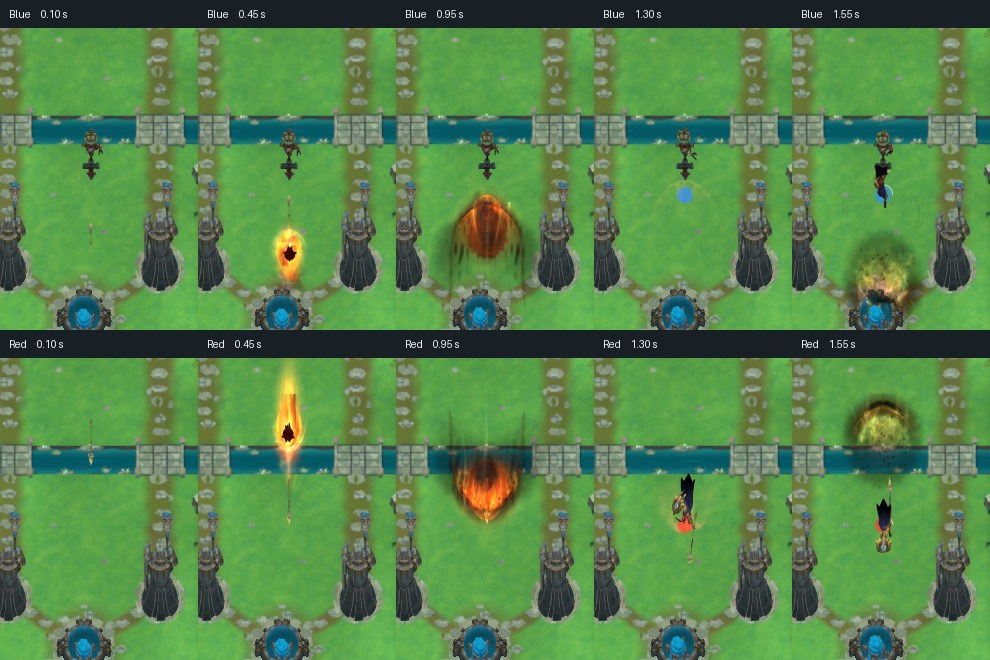
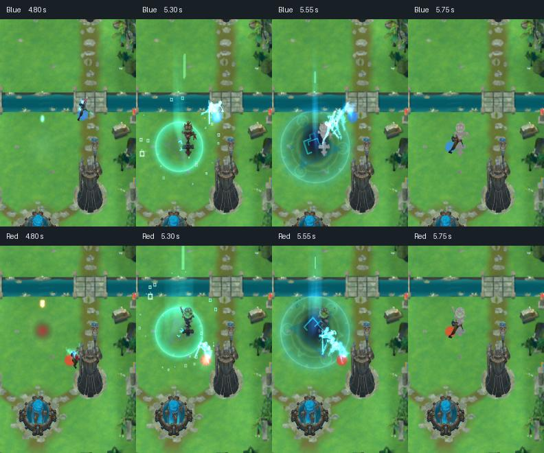
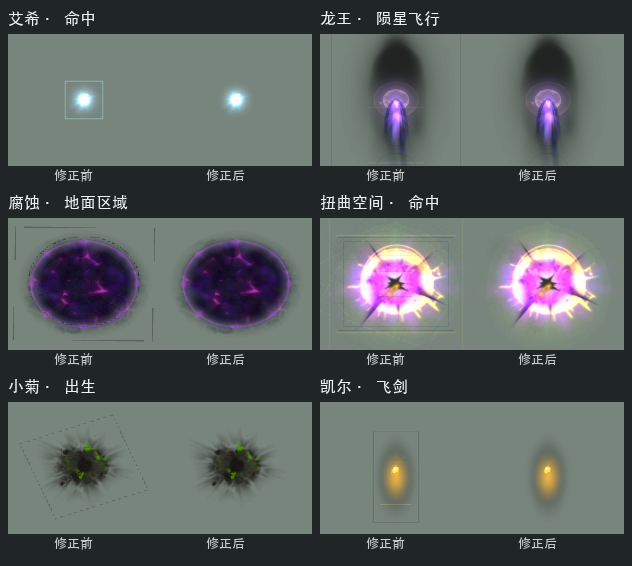

# 战斗特效逐项实测 · 2026-11-21

覆盖全部 100 张卡和 106 个技能选项。279 组近场、远场和长时战斗快照，加上 22 组分别从双方席位渲染的专项对局，合计 323 次战场回放。最终 290 / 290 套原生系统均有实战绘制记录，包含此前只能预览的 29 套。

从本机 LoL 16.19.8217343+branch.releases-16-19.content.release 的 68 个 WAD 重新核对了 **290 条系统定义、2,510 个发射器、2,003 个原始依赖块和 1,910 个发布文件**。独立长矛、入场剪影和出土碎石另有原始模型、纹理及动画来源清单。

## 原先仅可预览的 29 项

每个链接对应当前实战的首帧坐标、挂点、尺度、朝向和绘制时段。

| 对象 | 已在实战绘出的系统 |
| --- | --- |
| 蒸汽机器人 | [qcas](#fx-036)、[qmis](#fx-037)、[qreturn](#fx-038) |
| 艾克 | [end](#fx-051)、[r-RewindIndicator](#fx-053)、[r-RewindIndicator_Red](#fx-054)、[r-RewindPose1](#fx-055)、[r-RewindPose2](#fx-056)、[r-RewindPose3](#fx-057)、[r-RewindPose4](#fx-058)、[r-RewindPose5](#fx-059)、[r-RewindPose6](#fx-060)、[r-Tar_Impact](#fx-062)、[r-TimeDevice_Active](#fx-063)、[r-TrailEnd](#fx-064)、[r-TrailEnd_Red](#fx-065)、[vanish](#fx-066) |
| 费德提克 | [channel](#fx-079) |
| 尖端炮台 | [laser](#fx-104) |
| 杰斯 | [field_hit](#fx-117)、[ready_m](#fx-120)、[ready_r](#fx-121)、[stance_hammer](#fx-122)、[stance_m](#fx-123)、[stance_r](#fx-124) |
| 马尔扎哈 | [portal_end](#fx-151) |
| 潘森 | [spear](#fx-183) |
| 雷克塞 | [travel](#fx-195) |
| 虚空兽 | [trail](#fx-267) |

## 本轮组合与校准

| 对象 | 实战依据和核对结果 |
| --- | --- |
| 虚空之门、冰柱 | 虚空之门部署完成后切入 64 秒待机轨道，出生、待机和喷吐使用地面骨。冰柱主体保留上升结束时的造型，裂冰、烟雾和暗圈按各自源半径换算。实测技能使减速半径从 110 扩至 200，柱身仍为 ×0.36。 |
| 琴女、卡萨丁、德邦军旗 | 琴女治疗光环前 4 秒完整播放，随后循环第 2 至 4 秒。卡萨丁武器从第 2 秒的预热样本开始，军旗自第 1 秒取样、每 8 秒循环。 |
| 小炮、希维尔、雷克塞 | 小炮普攻仅取原始弹体，高速射击随武器骨旋转。希维尔护盾用中心骨静止位置扣去原始 85 单位的中心高度。雷克塞强化分别挂左右手，挥击进度随攻击段长度换算。 |
| 维迦、吉格斯 | 导入器沿原始皮肤 BIN 的资源映射读取子系统，牢笼的光束、尘土和陨石推进器，以及炸弹的引信、火花与拖尾随各自父粒子出生。 |
| 艾克 | 带回溯技能移动超过四秒，分别核对敌我指示、四秒前的蒙皮和当前背部装置。施法 0.25 秒后隐藏本体，随后 0.5 秒依序取六个历史位置，落点伤害触发受击层。刚接收基线时，缺失的历史骨骼用最早可用姿态，历史位置可读战斗状态。 |
| 杰斯 | 形态切换驱动三套姿态。锤形态就绪层挂武器骨，炮形态还绑定两侧间隙骨。电场每次实际命中分别给目标附着原生击中层。 |
| 蒸汽机器人 | 从右手原生挂点发射，用宿主成功钩爪记录的始点、目标、命中和收回 Tick 驱动拳头。去程和回程各 0.30 秒，缆绳两端随手与拳头移动。 |
| 潘森 | 独立斜矛 0–0.20 秒落到下牌点，0.20–0.65 秒下冲，0.65–1.30 秒滑行。原始 fly、slide 两段骨架动画分别挂在彗星坐标系。1.30 秒正式单位出现，1.35 秒由冲击罩死亡位置交给余波，2.25 秒结束。保留 5 个原生系统、69 个选用层和独立剪影。贯星长枪从矛骨出发，0.30 秒时抵达 120 场地单位的技能前缘。滑行剪影和彗星沿旧项目的二次减速曲线移动，冲击罩跟随当前战斗核心的扫掠位置。滑行中点两者最多相距 30 个场地单位，两端重合。 |
| 费德提克、尖端炮台、马尔扎哈 | 汲取按实际连接目标播放引导层和胸部牵引。炮台将穿透弹头与强化弹的电环、电光合成一束。召唤门原地开启，1.50 秒后播放关闭层。压制地面区读取独立区域的位置和半径 90，持续 5 秒。 |
| 雷克塞、虚空兽 | 遁地效果沿宿主找到的路径移动，抵达后停发并保留尾迹。出土将基础闪光、破土层以及原始岩石蒙皮动画按每块碎石的出生时刻合成。虚空兽起跳后，表现独立于已死亡的单位，按攻击动作前 23/30 秒采样；爆点由对建筑实际结算触发。 |
| 皮克斯、远程虚空鱼、沙兵 | 按旧项目自绘配方，在原始模型上重建 5 条吸血光流、9 条再生光流和由 24 粒沙组成的护盾。分别取 spine 或 Root 骨世界坐标。沙盾在护盾被打破或到期时收起。 |
| 卡牌大师、图奇 | 万能牌三枚弹体依次使用黄色、红色、蓝色原始子系统的 Card_Missile 层。图奇随公开隐身状态收束或散开，按旧项目配方绘制 12 团烟、9 道短线和地面波纹。 |

在独立大厅的正式双人房中，红方实际下潘森，双方浏览器均绘出了入场的五段粒子。另一次正式 AI 对局下牌后，回放在第 60 Tick 与权威战场状态一致。

同一相机下，蓝、红两方入场在五个采样时刻的战斗画面如下。

移动后的艾克在施法前、消失、回卷和落地时的位置见下图。

## 黑色线框

艾希命中、腐蚀地面、陨星等画面出现了贴图矩形轮廓。先对纹理坐标取模会在边界造成跳变，GPU 据此选错纹理细节层级，图集相邻格的像素也可能参与过滤。修正后按连续坐标计算采样梯度，在格内按原生寻址模式采样。另对潘森红方滑行第 19 Tick 单独隔离 3 个系统和各发射层，地面波现按旧项目地面四边形的纹理方向铺设。下图每对截图使用相同素材、相机、采样帧和背景。

## 逐卡和技能

旧版列逐项求值了 118 个卡牌和衍生对象的资源声明。没有独立声明时也运行了该卡。近场采样 8 秒，远场采样 11.5 秒，专项采样 17.5 或 32.5 秒，每个战斗 Tick 为 50 毫秒。远场以另一席位的相机和阵营着色重绘同一公开快照，另以实际红方施放验证军旗、牢笼等红方变体。

结果按技能列出近远两轮实际出图的系统，包括施法者、衍生单位、受击者及同场其他单位。专项中首次出现的系统另列。点击编号可查原始 BIN、代表场景的坐标、比例和时间。

| 卡牌 | 旧版声明的特效或表现脚本 | 各技能实际出图（系统编号） | 核对结果 |
| --- | --- | --- | --- |
| 剑魔 | 无独立资源声明 | 大灭 [001](#fx-001) [002](#fx-002) | 本卡列出的绑定均已出图。 |
| 空投熊 | airdrop_bear/impact、airdrop_bear/aura | 焚怒降临 [005](#fx-005) [006](#fx-006) [007](#fx-007) [008](#fx-008) [009](#fx-009) [010](#fx-010) [011](#fx-011) [014](#fx-014) 基础部署 [010](#fx-010) | 普通空投出落地冲击；强化提伯斯另有范围光环、躯干及左右肢体挂点。 |
| 艾尼维亚（冰晶凤凰） | anivia/missile、anivia/storm | 冰雪风暴 [012](#fx-012) [013](#fx-013) [083](#fx-083) | 本卡列出的绑定均已出图。 |
| H-28Q尖端炮台 | 无独立资源声明 | 海克斯穿透激光 [101](#fx-101) [102](#fx-102) [103](#fx-103) | 穿透束使用原生激光和两层电环电光。 |
| 艾希 | 无独立资源声明 | 万箭齐发 [015](#fx-015) [016](#fx-016) [017](#fx-017) | 本卡列出的绑定均已出图。 |
| 龙王 | aurelionsol_r/tell、aurelionsol_r/missile、aurelionsol_r/impact、aurelionsol_r/strong_tell、aurelionsol_r/strong_missile、aurelionsol_r/strong_impact、aurelionsol_r/wave、aurelionsol_q/beam、aurelionsol_q/end | 星落/天瀑 [014](#fx-014) [018](#fx-018) [019](#fx-019) [020](#fx-020) [021](#fx-021) [025](#fx-025) 专项新增 [022](#fx-022) [023](#fx-023) [024](#fx-024) [026](#fx-026) [083](#fx-083) | 普攻两端和普通陨星三段已出图。连续击杀攒满星屑后，强化预警、陨石、爆点和扩散波也已出图。 |
| 沙漠皇帝 | azir/basic_attack、azir/cast1、azir/cast2、azir/hit | 沙兵现身 [027](#fx-027) [028](#fx-028) [029](#fx-029) [030](#fx-030) [032](#fx-032) | 普攻 Weapon 挂点使用原生施法层；0.25 秒光束连接施法者与实际受击目标。 |
| 虚空女皇 | 无独立资源声明 | 虚空激流 [033](#fx-033) | 本卡列出的绑定均已出图。 |
| 蒸汽机器人 | blitzcrank/qcas、blitzcrank/qmis、blitzcrank/qreturn、blitzcrank/ebuf、blitzcrank/etar | 能量铁拳 [014](#fx-014) [034](#fx-034) [035](#fx-035) | 右手出拳、钩爪飞行与收回均实测。 |
| 聚合脉冲 | convergent_pulse/pulse、convergent_pulse/ball | 基础部署 [039](#fx-039) [040](#fx-040) 强化脉冲 [039](#fx-039) [040](#fx-040) | 本卡列出的绑定均已出图。 |
| 库奇 | corki_projectile_effect/bullet、corki_projectile_effect/missile | 火箭轰击 [041](#fx-041) [042](#fx-042) | 本卡列出的绑定均已出图。 |
| 腐蚀法术 | corrosion_ground_3d | 基础部署 [043](#fx-043) 强化腐蚀 [043](#fx-043) | 中心取宿主落点，以原生半径 284.64396 换算显示大小。 |
| 德莱厄斯 | 无独立资源声明 | 诺克萨斯断头台 [044](#fx-044) | 本卡列出的绑定均已出图。 |
| 德邦军旗 | demacian_standard/flag、demacian_standard/fall、demacian_standard/fall_red、demacian_standard/landing、demacian_standard/nova、demacian_standard/shield | 黄金圣盾 [045](#fx-045) [047](#fx-047) [048](#fx-048) [049](#fx-049) [050](#fx-050) 专项新增 [046](#fx-046) [083](#fx-083) | 核对了两队落旗、根挂点、落地、爆发和护盾。 |
| 时间刺客 | ekko/vanish、ekko/end、ekko/r-ChargeUp、ekko/r-RewindIndicator、ekko/r-TrailEnd、ekko/r-TrailEnd_Red、ekko/r-RewindIndicator_Red、ekko/r-TimeDevice_Active、ekko/r-Tar、ekko/r-Tar_Impact、ekko/r-RewindPose1、ekko/r-RewindPose2、ekko/r-RewindPose3、ekko/r-RewindPose4、ekko/r-RewindPose5、ekko/r-RewindPose6 | 时空断裂 [052](#fx-052) [061](#fx-061) | 双阵营指示、装置、六个历史残影及命中已实测。 |
| 扭曲空间 | event_horizon/warning、event_horizon/warning_red、event_horizon/cage、event_horizon/cage_red、event_horizon/meteor、event_horizon/impact、event_horizon/meteor_red、event_horizon/impact_red | 基础部署 [067](#fx-067) [068](#fx-068) [073](#fx-073) [074](#fx-074) 黑暗物质 [067](#fx-067) [068](#fx-068) [073](#fx-073) [074](#fx-074) 专项新增 [014](#fx-014) [015](#fx-015) [016](#fx-016) [069](#fx-069) [070](#fx-070) [071](#fx-071) [072](#fx-072) [083](#fx-083) | 双方分别施放时，预警、牢笼、陨石、命中四阶段均随观察方选色。 |
| H-28G进化炮台 | evolution_turret/spawn | 海克斯修复 [075](#fx-075) [105](#fx-105) [111](#fx-111) | 出生和炮击有独立来源，修理沿用迦娜治疗。 |
| 爆破酒桶 | explosive_cask_3d | 基础部署 [076](#fx-076) [077](#fx-077) [078](#fx-078) 烈性火药 [076](#fx-076) [077](#fx-077) [078](#fx-078) | 飞行使用固定 0.146 比例及抛物线，终点按半径缩放。单目标命中在实际受击处抬高 32。 |
| 终极闪光 | final_spark/cast、final_spark/beam | 基础部署 [081](#fx-081) [082](#fx-082) 夺目光辉 [081](#fx-081) [082](#fx-082) | 源轴向长 3410，对应玩法射程 800，从落点向阵营前方发射。 |
| 冰冻 | freeze_ground_3d/iceborn、freeze_ground_3d/trundle | 基础部署 [083](#fx-083) 强化冰冻 [083](#fx-083) [084](#fx-084) | 内环按源半径 310 换算，3 秒窗口映射 2 秒采样。强化外环按 1.25 倍玩法半径及源半径 790 换算；外环内侧遮罩还需验证。 |
| 盖伦 | 无独立资源声明 | 致命打击 [087](#fx-087) 审判 [086](#fx-086) | 本卡列出的绑定均已出图。 |
| 纳尔 | 无独立资源声明 | 怒气爆发 [014](#fx-014) [088](#fx-088) [089](#fx-089) | 本卡列出的绑定均已出图。 |
| 金币守卫 | self_stasis_resources | 完美时机 [290](#fx-290) | 自身进入凝滞后显示 Bard_Base_R_stasis_skin_full 的两层金身蒙皮，按实际状态结束。 |
| 法外狂徒 | graves/missile、graves/dash | 快速拔枪 [090](#fx-090) [091](#fx-091) | 普攻霰弹与快速拔枪按 0.015 × 40 换算，轨迹沿权威发射方向。 |
| 格温 | gwen_tristana/mist | 丝缕缠流 [094](#fx-094) 快刀乱剪 [092](#fx-092) | 圣霭保存施放时的区域中心，以源半径 425.593 换算。 |
| 治疗术 | 无独立资源声明 | 基础部署 [111](#fx-111) 强化治疗 [111](#fx-111) 过量治疗 [111](#fx-111) | 治疗术使用迦娜恢复层。 |
| 重装部队 | 无独立资源声明 | 男爵之力 [236](#fx-236) [265](#fx-265) | 本卡列出的绑定均已出图。 |
| 战争之影 | hecarim/qcas、hecarim/qbuf、hecarim/qtar、hecarim/aoe、hecarim/cas | 恐惧之灵 [096](#fx-096) [097](#fx-097) [098](#fx-098) [099](#fx-099) [100](#fx-100) | 普攻环以攻击时长重映射 0.968 秒采样，命中落在目标位置。 |
| 高地水晶 | 无独立资源声明 | 超级增援 [236](#fx-236) | 水晶的后续表现受生产时间和衍生单位控制。 本卡场景未见 [265](#fx-265)。 |
| 翠神 | ivern/basic | 小菊！ [014](#fx-014) [106](#fx-106) [107](#fx-107) [108](#fx-108) | 小菊另有出生和第三击击飞。 |
| 惊吓魔盒 | jack_in_the_box/missile、jack_in_the_box/aoe | 惊吓 [014](#fx-014) [109](#fx-109) [110](#fx-110) | 魔盒弹体按 0.007 × 40 等比缩放。 |
| 武器大师 | jax/buf、jax/cas、jax/tar | 反击风暴 [014](#fx-014) [112](#fx-112) [113](#fx-113) [114](#fx-114) | 闪避蓄力、反击释放及敌方命中各自触发。 |
| 未来守护者 | jayce/stance_m、jayce/swap_m、jayce/swap_r、jayce/stance_r、jayce/stance_hammer、jayce/bullet、jayce/first_hit_m、jayce/first_hit_r、jayce/ready_m、jayce/ready_r、jayce/w_ready2、jayce/field、jayce/field_hit | 超能电荷 / 闪电领域 [115](#fx-115) [116](#fx-116) [118](#fx-118) [119](#fx-119) [125](#fx-125) [127](#fx-127) 专项新增 [126](#fx-126) | 两种武器就绪、三套姿态与每次电场命中均已实测。 |
| 金克丝 | jinx_projectile_effect/rocket、jinx_projectile_effect/bullet | 枪炮交响曲！ [129](#fx-129) 专项新增 [128](#fx-128) | 本卡列出的绑定均已出图。 |
| 虚空行者 | kassadin/idle_blade、kassadin/appear、kassadin/vanish | 虚空行走 [130](#fx-130) [131](#fx-131) [132](#fx-132) 专项新增 [085](#fx-085) [171](#fx-171) | 常驻臂刃使用武器骨，位移前后分别出图。 |
| 正义天使 | 无独立资源声明 | 星界恩典 [133](#fx-133) 专项新增 [134](#fx-134) [135](#fx-135) | 单独部署远程形态后，观察到飞剑和继续穿过目标的独立剑波。 |
| 凯隐 | 无独立资源声明 | 巨镰横扫 [136](#fx-136) [137](#fx-137) | 本卡列出的绑定均已出图。 |
| 大型电击法术 | lightning_spell_effect_3d/lightning | 基础部署 [014](#fx-014) [138](#fx-138) 递增电击 [014](#fx-014) [138](#fx-138) | 已纠正与小电互换的素材。电刑在受击位置按 90/550 缩放。 |
| 璐璐 | 无独立资源声明 | 狂野生长 [141](#fx-141) [142](#fx-142) [143](#fx-143) | 本卡列出的绑定均已出图。 |
| 熔岩巨兽 | malphite/shield、malphite/break、malphite/cas、malphite/aoe | 大地震颤 [083](#fx-083) [144](#fx-144) [146](#fx-146) [147](#fx-147) 专项新增 [145](#fx-145) | 出生护盾、施法和地面爆发已出图。多名敌人消耗完部署护盾后，另外观察到了破盾层。 |
| 虚空先知 | malzahar/portal_start、malzahar/portal_end、malzahar/cast、nether_grasp/zone、nether_grasp/beam | 冥府之握 [014](#fx-014) [148](#fx-148) [150](#fx-150) [153](#fx-153) 虚空虫群 [148](#fx-148) [149](#fx-149) [150](#fx-150) [153](#fx-153) | 压制束、半径 90 的持续地面区以及召唤门开闭均已实测。 |
| 剑圣 | 无独立资源声明 | 高原血统 [154](#fx-154) | 本卡列出的绑定均已出图。 |
| 中型雷电法术 | medium_lightning_3d | 基础部署 [156](#fx-156) [159](#fx-159) [160](#fx-160) 霹天雳地 [156](#fx-156) [159](#fx-159) [160](#fx-160) 专项新增 [014](#fx-014) [155](#fx-155) [157](#fx-157) [158](#fx-158) | 实测命中边塔后，塔体失效、命中和裂纹三层同时开始，并按塔的半径缩放。 |
| 终极爆弹 | mega_inferno_bomb/warning_ally、mega_inferno_bomb/warning_enemy、mega_inferno_bomb/missile、mega_inferno_bomb/impact | 基础部署 [161](#fx-161) [162](#fx-162) [163](#fx-163) [164](#fx-164) 地狱火炮 [161](#fx-161) [162](#fx-162) [163](#fx-163) [164](#fx-164) | 双方预警、抛物线使用宿主落点和命中时刻，源预警按飞行时间重映射。 |
| 近战兵 | 无独立资源声明 | 男爵之力 [265](#fx-265) | 本卡列出的绑定均已出图。 |
| 近战兵小队 | 无独立资源声明 | 男爵之力 [265](#fx-265) | 本卡列出的绑定均已出图。 |
| 小兵分队 | 无独立资源声明 | 男爵之力 [236](#fx-236) [265](#fx-265) | 本卡列出的绑定均已出图。 |
| 镜像法术 | 无独立资源声明 | 基础部署 [015](#fx-015) [016](#fx-016) | 先部署艾希再复制，记录复制单位的实际出图。 |
| 赏金猎人 | missfortune_w/trail、missfortune_w/left、missfortune_w/right、missfortune_w/end_left、missfortune_w/end_right | 大步流星 [165](#fx-165) [166](#fx-166) [167](#fx-167) [168](#fx-168) [169](#fx-169) [170](#fx-170) | 疾步启动跟随双枪，结束时各枪单独冒火花。 |
| 永恒梦魇 | nocturne/shield、nocturne/cleave | 黑暗庇护 [173](#fx-173) 暗影之刃 [172](#fx-172) | 本卡列出的绑定均已出图。 |
| 狂战士 | olaf/cas、olaf/shield、olaf/buf_glow、olaf/buf_blood、olaf/r_cas、olaf/r_buf、olaf/r_buff_weap | 诸神黄昏 [177](#fx-177) [178](#fx-178) [179](#fx-179) 残暴打击 [174](#fx-174) [175](#fx-175) [176](#fx-176) [180](#fx-180) | W 的手、武器和护盾与 R 的免控和双武器使用不同原生层。 |
| 奥恩 | 无独立资源声明 | 熔铸冲锋 [014](#fx-014) [181](#fx-181) [182](#fx-182) | 本卡列出的绑定均已出图。 |
| 潘森 | pantheon_arrival | 贯星长枪 未见粒子 | 预部署长矛、双动画剪影、冲击罩、余波和贯星长枪均已实测。 |
| 凛冬之柱 | pillar_of_ice/pillar | 冰封领域 [083](#fx-083) [184](#fx-184) [251](#fx-251) | 本卡列出的绑定均已出图。 |
| 皮克斯 | pix_lifesteal/lifesteal | 仙灵汲取 [111](#fx-111) [143](#fx-143) | 吸血启动光流挂 spine，持续覆层跟随原始模型。 |
| 庇护清泉 | pool_of_reflection/area、pool_of_reflection/area_red、pool_of_reflection/shield、pool_of_reflection/break | 基础部署 [185](#fx-185) [186](#fx-186) [187](#fx-187) [188](#fx-188) 渲浓 [185](#fx-185) [186](#fx-186) [187](#fx-187) [188](#fx-188) | 区域、受益目标护盾和消退分别触发。 |
| 火药桶 | powder_keg/explosion | 烈性火药 [189](#fx-189) | 爆炸以固定 0.5 比例锚在桶的位置。 |
| 女王巢穴 | 无独立资源声明 | 女王之怒 [192](#fx-192) | 已检查编队、目标及技能条件。 本卡场景未见 [190](#fx-190) [191](#fx-191) [193](#fx-193) [194](#fx-194)。 |
| 远程兵 | 无独立资源声明 | 男爵之力 [236](#fx-236) [265](#fx-265) | 本卡列出的绑定均已出图。 |
| 远程兵小队 | 无独立资源声明 | 男爵之力 [236](#fx-236) [265](#fx-265) | 本卡列出的绑定均已出图。 |
| 虚空遁地兽 | reksai/travel、reksai/emerge、reksai/emerge_cast、reksai/buff、reksai/swipe、reksai/swipe_second | 女王之怒 [190](#fx-190) [191](#fx-191) [193](#fx-193) [194](#fx-194) | 从基地外围沿寻路轨迹移动，出土组合包含逐粒子采样的碎石骨架。 |
| 峡谷先锋 | 无独立资源声明 | 旋转重拳 [237](#fx-237) | 本卡列出的绑定均已出图。 |
| 沙漠玫瑰 | samira/bullet、samira/ready、samira/cas | 炼狱扳机 [196](#fx-196) [197](#fx-197) [198](#fx-198) | 弹体、满评价模型附着光和 R 均已出图。就绪取宿主满资源，施法按 0.3 缩放。 |
| 草间人 | 无独立资源声明 | 巫骇草人 [080](#fx-080) [111](#fx-111) | 变身后按实战连接目标附着引导层，并从胸部骨骼连向各目标。 |
| 峡谷迅捷蟹 | normal_ward_antenna_wake、shrine_green、shrine_red、randuin | 谦卑 [083](#fx-083) [200](#fx-200) 专项新增 [199](#fx-199) [201](#fx-201) [202](#fx-202) | 专项击杀两方河蟹，死亡两秒后在死亡位置生成两方的视野圈和天线。 |
| 腕豪 | sett/full_body、sett/cast_body、sett/warning、sett/min、sett/max | 蓄意轰拳 [209](#fx-209) [210](#fx-210) 专项新增 [206](#fx-206) [207](#fx-207) [208](#fx-208) | 围攻补测出现普通与满豪意分支。正式释放时按拳的起点和面向出图。 |
| 攢聚雷 | severing_bolt/warning、severing_bolt/warning_red、severing_bolt/impact、severing_bolt/hit | 基础部署 [211](#fx-211) [212](#fx-212) [213](#fx-213) [214](#fx-214) 攢聚惊雷 [211](#fx-211) [212](#fx-212) [213](#fx-213) [214](#fx-214) | 敌方额外预警与通用预警叠加，逐目标命中使用实际受击位置。 |
| 恕瑞玛卫队 | azir/spawn、sand_ward/ward | 黄沙庇护 [031](#fx-031) | 受保护的沙兵各自在 Root 骨聚沙，按实际护盾存续显示。 |
| 炮车兵 | 无独立资源声明 | 男爵之力 [236](#fx-236) [265](#fx-265) | 本卡列出的绑定均已出图。 |
| 炮车部队 | 无独立资源声明 | 男爵之力 [236](#fx-236) [265](#fx-265) | 本卡列出的绑定均已出图。 |
| 赛恩 | sion_w/Cas、sion_w/Shield、sion_w/Nova | 灵魂熔炉 [215](#fx-215) [216](#fx-216) [217](#fx-217) | 护盾粒子由爆炸护盾自身的状态驱动。 |
| 战争女神 | sivir/blade、sivir/shield | 法术护盾 [218](#fx-218) [219](#fx-219) 专项新增 [111](#fx-111) [220](#fx-220) | 本卡列出的绑定均已出图。 |
| 太阳耀斑 | solar_flare/warning、solar_flare/warning_red、solar_flare/impact、solar_flare/mark、solar_flare/consume | 基础部署 [014](#fx-014) [222](#fx-222) [224](#fx-224) [225](#fx-225) 日光 [014](#fx-014) [222](#fx-222) [223](#fx-223) [224](#fx-224) [225](#fx-225) 专项新增 [015](#fx-015) [016](#fx-016) [083](#fx-083) [221](#fx-221) | 已分别观察到预警、落地、目标日光标记、友军攻击消耗标记。 |
| 琴瑟仙女 | sona/basic、sona/heal_self、sona/wave、sona/cast | 狂舞终乐章 [014](#fx-014) [226](#fx-226) [227](#fx-227) [228](#fx-228) [229](#fx-229) | 治疗光环跟随根，R 音波使用武器发射点和宿主飞行距离。 |
| 灵魂触手 | soul_tentacle/slam、soul_tentacle/base_active、soul_tentacle/activation、soul_tentacle/avatar、soul_tentacle/indicator_blue、soul_tentacle/indicator_red | 过界信仰 [230](#fx-230) [231](#fx-231) [232](#fx-232) [233](#fx-233) [235](#fx-235) 专项新增 [234](#fx-234) | 两方预警及拍击使用同一条 80 × 360 判定，每次挥击生成一份。 |
| 凝滞法术 | stasis_spell_effect_3d | 基础部署 [238](#fx-238) [239](#fx-239) [240](#fx-240) 友军优待 [238](#fx-238) [239](#fx-239) [240](#fx-240) | 预警从源 0.6 秒开始，随玩法进度推进 0.8 秒。飞行和落地分别缩放。 |
| 星芒凝汇 | stellar_convergence/zone、stellar_convergence/zone_red、stellar_convergence/core、stellar_convergence/core_red、stellar_convergence/execute | 基础部署 [241](#fx-241) [242](#fx-242) [244](#fx-244) [245](#fx-245) 黑洞吞噬 [241](#fx-241) [242](#fx-242) [244](#fx-244) [245](#fx-245) 专项新增 [015](#fx-015) [016](#fx-016) [083](#fx-083) [243](#fx-243) | 按外圈 160、内核 60 的相对半径校正，专项观察到处决。 |
| 太阳圆盘 | locket_effect_3d | 日耀庇护 [140](#fx-140) | 本卡列出的绑定均已出图。 |
| 超级兵 | 无独立资源声明 | 男爵之力 [265](#fx-265) | 本卡列出的绑定均已出图。 |
| 攻城部队 | 无独立资源声明 | 男爵之力 [265](#fx-265) | 本卡列出的绑定均已出图。 |
| 训练木桩 | burst、native/Buff | 余震 [003](#fx-003) [004](#fx-004) | 余震蓄力附身，释放时地面范围按 110/311.403 缩放。 |
| 提莫 | 无独立资源声明 | 致盲 [246](#fx-246) [247](#fx-247) | 本卡列出的绑定均已出图。 |
| 荆棘喷射者 | thorn_spitter/missile、thorn_spitter/buff | 致命棘刺 [248](#fx-248) [249](#fx-249) | 本卡列出的绑定均已出图。 |
| 浪潮法术 | tidal_wave_3d | 基础部署 [250](#fx-250) 踏浪而行 [250](#fx-250) | 以原生局部 Y 为浪潮行进方向，按玩法实际宽度换算。 |
| 墓碑 | 无独立资源声明 | 亡者集结 [152](#fx-152) | 当前复用马尔扎哈传送门的开启层。 |
| 麦林炮手 | gwen_tristana/missile、gwen_tristana/rapid | 急速射击 [093](#fx-093) [095](#fx-095) | 本卡列出的绑定均已出图。 |
| 蛮族之王 | undying_rage | 无尽怒火 [252](#fx-252) | 本卡列出的绑定均已出图。 |
| 卡牌大师 | twisted_fate_card_model/basic、twisted_fate_card_model/wild_blue、twisted_fate_card_model/wild_red、twisted_fate_card_model/wild_yellow | 万能牌 [253](#fx-253) [254](#fx-254) | 普攻和三枚分色卡面均使用对应原始层。 |
| 图奇 | stealth_transition_3d | 火力全开 [255](#fx-255) [256](#fx-256) [257](#fx-257) | 公开隐身切换驱动收束、迸散。 |
| 藤蔓鞭击者 | thorn_spitter/buff | 缠绕之根 [248](#fx-248) | 本卡列出的绑定均已出图。 |
| 兹若特传送门 | void_gate/spawn、void_gate/idle、void_gate/spit、void_gate/death | 虚空迸发 [258](#fx-258) [259](#fx-259) [260](#fx-260) [261](#fx-261) [263](#fx-263) [266](#fx-266) | 本卡列出的绑定均已出图。 |
| 虚空迅捷蟹 | void_ward_antenna_wake、void_z_visionring_green、void_z_visionring_red | 归于虚空 [203](#fx-203) [204](#fx-204) [205](#fx-205) [262](#fx-262) | 本卡列出的绑定均已出图。 |
| 虚空兽 | sacrifice_leap_3d、void_spawn/burst、void_spawn/death、void_spawn/energy、void_spawn/glow | 虚空强化 [263](#fx-263) [264](#fx-264) | 独立献祭轨迹持有攻击模型至命中，在建筑近侧衔接爆点。 |
| 虚空召唤 | void_summoning/zone | 基础部署 [268](#fx-268) 虚空献祭 [268](#fx-268) | 区域以源半径 420 对应玩法半径。 |
| 远程虚空鱼 | voidfish_ranged/spawn、voidfish_ranged/missile、voidfish_regeneration/regeneration | 虚空再生 [269](#fx-269) [270](#fx-270) | 再生窗口显示九条光流和模型覆层。 |
| 远程虚空鱼大军 | voidfish_ranged/spawn、voidfish_ranged/missile、voidfish_regeneration/regeneration | 虚空再生 [269](#fx-269) [270](#fx-270) | 编队成员按各自再生状态使用同一套躯干覆层。 |
| 赵信 | xin_dash/hit、xin_dash/buff | 无畏冲锋 [271](#fx-271) [272](#fx-272) [274](#fx-274) 新月护卫 [273](#fx-273) | 本卡列出的绑定均已出图。 |
| 牧魂人 | 无独立资源声明 | 临终仪式 [275](#fx-275) | 本卡列出的绑定均已出图。 |
| 电击法术 | lightning_spell_effect_3d/zap | 基础部署 [014](#fx-014) [139](#fx-139) 多重电击 [014](#fx-014) [139](#fx-139) | 已纠正与大电互换的素材。风暴狂涌按 90/1050 缩放。 |
| 爆破鬼才 | ziggs/basic、ziggs/hit、ziggs/missile、ziggs/missile2、ziggs/missile3、ziggs/passive | 弹跳炸弹 [276](#fx-276) [277](#fx-277) [278](#fx-278) [279](#fx-279) [280](#fx-280) [281](#fx-281) | 飞弹分三次弹跳，按 0.56 等比缩放；强化普攻待发层绑定 Bomb 骨。 |

## 衍生对象

对照对象使用旧版标识和 V1 实际单位标识；同场还可能有其他单位产生粒子。

| 对象 | 旧版资源声明 | 快照中出现过的测试卡 |
| --- | --- | --- |
| anivia_egg | 无独立资源声明 | 本轮快照未出现此独立标识 |
| daisy | ivern/spawn、ivern/slam | 翠神 |
| enraged_reksai | reksai/swipe、reksai/swipe_second、reksai/buff | 女王巢穴 |
| fiddlesticks | 无独立资源声明 | 草间人 |
| imp | 无独立资源声明 | 龙王、墓碑 |
| kayle_ranged | native/sword、native/wave | 正义天使 |
| kayn_assassin | 无独立资源声明 | 本轮快照未出现此独立标识 |
| kayn_slayer | 无独立资源声明 | 本轮快照未出现此独立标识 |
| nest_reksai | 无独立资源声明 | 本轮快照未出现此独立标识 |
| olaf_single | olaf/cas、olaf/shield、olaf/buf_glow、olaf/buf_blood、olaf/r_cas、olaf/r_buf、olaf/r_buff_weap | 本轮快照未出现此独立标识 |
| pix_single | pix_lifesteal/lifesteal | 本轮快照未出现此独立标识 |
| sand_soldier | azir/spawn、sand_ward/ward | 沙漠皇帝 |
| tibbers | airdrop_bear/body、airdrop_bear/arm、airdrop_bear/hand、airdrop_bear/leg、airdrop_bear/foot | 空投熊 |
| void_spawn_single | sacrifice_leap_3d、void_spawn/burst、void_spawn/death、void_spawn/energy、void_spawn/glow、void_spawn/spawn、void_spawn/trail | 兹若特传送门 |
| voidfish | voidfish_ranged/spawn | 虚空召唤 |
| voidfish_ranged_single | voidfish_ranged/spawn、voidfish_ranged/missile、voidfish_regeneration/regeneration | 本轮快照未出现此独立标识 |
| voidling | malzahar/spawn | 虚空先知 |
| voidmite | 无独立资源声明 | 峡谷先锋 |

## 原生系统、挂点与绘制记录

216 套可与旧工程同名采样对照。对照项包括旧播放器实际启用的发射层及采样窗口。雷克塞的碎石另由原生蒙皮播放，琴女音波使用 0.5 秒发射加 1.5 秒收尾。其余 74 套按旧项目的组合、发射挂点或自绘表现寻找原始 WAD 系统。旧版自绘弹体与新版粒子的材质和轮廓可能不同。

下表每行选取一场实际绘出该系统的对局。位置依次为横向、高度、纵向，原点位于场地中心。尺度为每个原生单位对应的场地单位。根节点旋转按 Three.js 的 X、Y、Z、W 顺序记录。场景内首次与末次显示之间可能包含多次施法。时间轴以场景开始为零，资源采样时长、单次出图时长和技能的持续时间分别计算。

| 编号／系统 | 原 WAD · BIN 条目 | 采样（秒 × fps）及旧版依据 | 代表场景及绘制时段（秒） | 挂点或定位 · 首帧位置 · 尺度 | 首帧旋转（四元数） |
| --- | --- | --- | --- | --- | --- |
| 001 `aatrox/empowered` | Aatrox · `Aatrox_Base_R_SpeedBuff` | 2 × 30 · 独立适配 | 剑魔·大灭·近场·蓝视角，1.45–2.35 | 单位 · (20, 0, 180.5) · ×0.4 | (0, 1, 0, 0) |
| 002 `aatrox/hit` | Aatrox · `Aatrox_Base_AA_Hit_Tar01` | 2 × 30 · 独立适配 | 剑魔·大灭·近场·蓝视角，1.25–7.9 | 接触点 · (20, 0, 140) · ×0.4 | (0, 1, 0, 0) |
| 003 `aftershock/native/AOE` | Global · `Perks_Aftershock_AOE` | 3 × 60 · 同名采样 | 训练木桩·余震·近场·蓝视角，3.95–5.6 | 技能阶段事件 · (40, 0, 200) · ×0.353 | (0, 1, 0, 0) |
| 004 `aftershock/native/Buff` | Global · `Perks_Aftershock_Buff` | 3 × 60 · 同名采样 | 训练木桩·余震·近场·蓝视角，1.5–3.85 | 单位 · (40, -0.836, 200) · ×0.4 | (0, 1, 0, 0) |
| 005 `airdrop_bear/arm` | Annie · `AnnieTibbers_Base_Idle_arm` | 10 × 60 · 同名采样 | 空投熊·焚怒降临·近场·蓝视角，1.55–8 | R_Elbow · (11.288, 48.816, 222.802) · ×0.4 | (-0.197, 0.695, -0.595, 0.352) |
| 006 `airdrop_bear/aura` | Annie · `AnnieTibbers_Base_Idle_Ground` | 10 × 60 · 同名采样 | 空投熊·焚怒降临·近场·蓝视角，1.55–8 | 单位 · (20, 0, 183.5) · ×0.357 | (0, 1, 0, 0) |
| 007 `airdrop_bear/body` | Annie · `AnnieTibbers_Base_Idle_body` | 10 × 60 · 同名采样 | 空投熊·焚怒降临·近场·蓝视角，1.55–8 | spine1 · (16.835, 31.224, 182.577) · ×0.4 | (0.027, 0.938, 0.043, -0.343) |
| 008 `airdrop_bear/foot` | Annie · `AnnieTibbers_Base_Idle_foot` | 10 × 60 · 同名采样 | 空投熊·焚怒降临·近场·蓝视角，1.55–8 | R_foot · (3.021, 6.992, 192.506) · ×0.4 | (0.35, -0.35, -0.615, 0.615) |
| 009 `airdrop_bear/hand` | Annie · `AnnieTibbers_Base_Idle_hand` | 10 × 60 · 同名采样 | 空投熊·焚怒降临·近场·蓝视角，1.55–8 | R_Buffbone_Glb_hand_Loc · (-2.879, 34.292, 217.461) · ×0.4 | (0.426, -0.463, 0.75, 0.203) |
| 010 `airdrop_bear/impact` | Annie · `Annie_Base_R_cas` | 5 × 60 · 同名采样 | 空投熊·焚怒降临·近场·蓝视角，1.55–3.75 | 法术坐标 · (20, 0, 180) · ×0.385 | (0, 0, 0, 1) |
| 011 `airdrop_bear/leg` | Annie · `AnnieTibbers_Base_Idle_leg` | 10 × 60 · 同名采样 | 空投熊·焚怒降临·近场·蓝视角，1.55–8 | R_KneeLower · (0.662, 12.775, 189.111) · ×0.4 | (0.043, -0.318, -0.482, 0.815) |
| 012 `anivia/missile` | Anivia · `Anivia_Base_BA_Mis` | 3 × 60 · 同名采样 | 艾尼维亚（冰晶凤凰）·冰雪风暴·远场·红视角，2.9–11.5 | 弹体路径 · (63.747, 83.183, -209.023) · ×0.44 | (0.53, 0.401, 0.679, -0.313) |
| 013 `anivia/storm` | Anivia · `Anivia_Base_R_AOE_Green` | 3 × 60 · 同名采样 | 艾尼维亚（冰晶凤凰）·冰雪风暴·近场·蓝视角，3.05–5.1 | 区域中心 · (20, 0, 55) · ×0.217 | (0, 1, 0, 0) |
| 014 `annie/stunned` | Annie · `Annie_Base_P_Stun` | 2 × 30 · 独立适配 | 蒸汽机器人·蓝方施放·组合·蓝视角，3.6–4.5 | 单位 · (20, 36, 143) · ×0.25 | (0, 0, 0, 1) |
| 015 `ashe/arrow` | Ashe · `Ashe_Base_BA_Mis` | 3 × 60 · 独立适配 | 艾希·万箭齐发·远场·红视角，2.2–11.5 | 弹体路径 · (68.009, 51.733, -177.085) · ×0.4 | (0.576, 0.414, 0.562, -0.425) |
| 016 `ashe/hit` | Ashe · `Ashe_Base_BA_tar` | 3 × 60 · 独立适配 | 艾希·万箭齐发·近场·蓝视角，1.15–8 | 命中点 · (20, 18, 154.5) · ×0.4 | (0, 0, 0, 1) |
| 017 `ashe/volley` | Ashe · `Ashe_Base_W_mis` | 3 × 60 · 独立适配 | 艾希·万箭齐发·远场·红视角，1.3–2.1 | 弹体路径 · (55.178, 72.323, -203.63) · ×0.4 | (0.622, 0.337, 0.337, -0.622) |
| 018 `aurelionsol_q` | AurelionSol · `AurelionSol_Base_Q_Beam` | 4 × 60 · 同名采样 | 龙王·星落/天瀑·近场·蓝视角，1.05–8 | 引导两端 · (20, 18, 180) · ×0.24 | (0, 1, -0.01, 0) |
| 019 `aurelionsol_q/end` | AurelionSol · `AurelionSol_Base_Q_Beam_End` | 3 × 60 · 独立适配 | 龙王·星落/天瀑·近场·蓝视角，1.05–8 | 引导目标 · (20, 17.164, 140) · ×0.24 | (0, 1, 0, 0) |
| 020 `aurelionsol_r/impact` | AurelionSol · `AurelionSol_Base_R_Impact` | 4 × 60 · 同名采样 | 龙王·星落/天瀑·近场·蓝视角，3.1–7.05 | 冲击位置 · (20, 0, 5) · ×0.164 | (0, 1, 0, 0) |
| 021 `aurelionsol_r/missile` | AurelionSol · `AurelionSol_Base_R_Mis` | 4 × 60 · 同名采样 | 龙王·星落/天瀑·近场·蓝视角，1.85–3 | 陨石路径 · (20, 554.957, 5) · ×0.219 | (0, 0, -1, 0) |
| 022 `aurelionsol_r/strong_impact` | AurelionSol · `AurelionSol_Base_R_Calamity_Impact` | 4 × 60 · 同名采样 | 龙王·长时·红视角，18.45–22.4 | 冲击位置 · (-129.797, 0, 193.903) · ×0.164 | (0, 0, 0, 1) |
| 023 `aurelionsol_r/strong_missile` | AurelionSol · `AurelionSol_Base_R_Calamity_Mis` | 4 × 60 · 同名采样 | 龙王·长时·红视角，16.45–18.35 | 陨石路径 · (-129.797, 563.628, 193.903) · ×0.219 | (0.975, 0, 0.224, 0) |
| 024 `aurelionsol_r/strong_tell` | AurelionSol · `AurelionSol_Base_R_Calamity_Tell` | 4 × 60 · 同名采样 | 龙王·长时·红视角，16.45–18.35 | 区域中心 · (-129.797, 0, 193.903) · ×0.263 | (0, -0.224, 0, 0.975) |
| 025 `aurelionsol_r/tell` | AurelionSol · `AurelionSol_Base_R_Tell` | 4 × 60 · 同名采样 | 龙王·星落/天瀑·近场·蓝视角，1.85–3 | 区域中心 · (20, 0, 5) · ×0.263 | (0, 1, 0, 0) |
| 026 `aurelionsol_r/wave` | AurelionSol · `AurelionSol_Base_R_Calamity_Shockwave` | 4 × 60 · 同名采样 | 龙王·长时·红视角，18.45–21.15 | 区域中心 · (-129.797, 0, 193.903) · ×0.083 | (0, -0.224, 0, 0.975) |
| 027 `azir/beam` | Azir · `Azir_Base_BA_Beam` | 0.25 × 60 · 独立适配 | 沙漠皇帝·沙兵现身·近场·蓝视角，3.05–8 | 施法者与目标 · (8.579, 62.947, 17.699) · ×0.44 | (0.177, 0.046, -0.008, 0.983) |
| 028 `azir/cast1` | Azir · `Azir_base_BA_cas` | 0.8 × 60 · 同名采样 | 沙漠皇帝·沙兵现身·近场·蓝视角，2.85–6.55 | Weapon · (4.296, 77.462, 227.719) · ×0.44 | (0.745, -0.557, 0.141, 0.339) |
| 029 `azir/cast2` | Azir · `Azir_base_BA2_cas` | 0.8 × 60 · 同名采样 | 沙漠皇帝·沙兵现身·近场·蓝视角，4.5–8 | Weapon · (23.96, 71.904, 275.663) · ×0.44 | (0.633, 0.657, -0.402, -0.074) |
| 030 `azir/hit` | Azir · `Azir_base_BA_tar` | 0.7 × 60 · 同名采样 | 沙漠皇帝·沙兵现身·近场·蓝视角，3.05–8 | 接触点 · (20, 0, 140) · ×0.44 | (0, 1, 0, 0) |
| 031 `azir/shield` | Azir · `Azir_Base_E_Shield` | 2 × 30 · 独立适配 | 恕瑞玛卫队·蓝方施放·组合·蓝视角，3–4.75 | 施法位置 · (-175.893, 0, 143.802) · ×0.4 | (0, 0.78, 0, 0.625) |
| 032 `azir/spawn` | Azir · `Azir_Base_W_SpawnIn` | 1.8 × 60 · 同名采样 | 沙漠皇帝·沙兵现身·近场·蓝视角，2.3–3.4 | 出生或死亡位置 · (62, 0, 180.5) · ×0.4 | (0, 1, 0, 0) |
| 033 `belveth/dash` | Belveth · `Belveth_Base_Q_Dash` | 2 × 30 · 独立适配 | 虚空女皇·虚空激流·近场·蓝视角，1.45–1.75 | 单位 · (20, 73.489, 165) · ×0.4 | (0, 1, 0, 0) |
| 034 `blitzcrank/ebuf` | Blitzcrank · `Blitzcrank_Base_E_buf` | 3 × 60 · 同名采样 | 蒸汽机器人·蓝方施放·组合·蓝视角，2.8–5.75 | 施法位置 · (20, 0, 180) · ×0.4 | (0, 1, 0, 0) |
| 035 `blitzcrank/etar` | Blitzcrank · `Blitzcrank_Base_E_tar_1` | 1.5 × 60 · 同名采样 | 蒸汽机器人·蓝方施放·组合·蓝视角，3.6–4.25 | 接触点 · (20, 0, 143) · ×0.425 | (0, 1, 0, 0) |
| 036 `blitzcrank/qcas` | Blitzcrank · `Blitzcrank_Base_Q_cas` | 1.5 × 60 · 同名采样 | 蒸汽机器人·蓝方施放·组合·蓝视角，2.1–2.55 | 入场或移动路径 · (48.215, 29.412, 148.17) · ×0.425 | (0, 1, 0, 0) |
| 037 `blitzcrank/qmis` | Blitzcrank · `Blitzcrank_Base_Q_mis` | 1.5 × 60 · 同名采样 | 蒸汽机器人·蓝方施放·组合·蓝视角，2.05–2.25 | 入场或移动路径 · (48.026, 3.04, 107.069) · ×0.425 | (0, 1, 0, 0) |
| 038 `blitzcrank/qreturn` | Blitzcrank · `Blitzcrank_Base_Q_mis_return` | 1.5 × 60 · 同名采样 | 蒸汽机器人·蓝方施放·组合·蓝视角，2.35–2.55 | 入场或移动路径 · (24.884, 22.424, 72.919) · ×0.425 | (0, 1, 0, 0) |
| 039 `convergent_pulse/ball` | Orianna · `Orianna_Base_R_VacuumIndicatorSelfNoRing` | 5 × 60 · 同名采样 | 聚合脉冲·基础部署·近场·蓝视角，0.05–1.4 | 法术坐标 · (20, 8.318, 180) · ×0.277 | (0, 0, 0, 1) |
| 040 `convergent_pulse/pulse` | Orianna · `Orianna_Base_R_VacuumIndicator` | 5 × 60 · 同名采样 | 聚合脉冲·基础部署·近场·蓝视角，0.05–2.2 | 法术坐标 · (20, 8.318, 180) · ×0.277 | (0, 0, 0, 1) |
| 041 `corki/bullet` | Corki · `Corki_Base_BA_mis` | 2 × 30 · 独立适配 | 库奇·火箭轰击·远场·红视角，1.7–11.5 | 弹体路径 · (68.187, 75.666, -180) · ×0.4 | (0.605, 0.366, 0.605, -0.366) |
| 042 `corki/rocket` | Corki · `Corki_Base_R_mis` | 2 × 30 · 独立适配 | 库奇·火箭轰击·远场·红视角，1.25–1.9 | 弹体路径 · (22.916, 164.405, -180) · ×0.4 | (0.5, 0.5, 0.5, -0.5) |
| 043 `corrosion/area` | Morgana · `Morgana_Base_W_Tar_Update` | 3 × 60 · 独立适配 | 腐蚀法术·基础部署·近场·蓝视角，0.05–4.95 | 法术坐标 · (20, 0, 180) · ×0.386 | (0, 0, 0, 1) |
| 044 `darius/execute` | Darius · `darius_Base_R_cast_axe` | 2 × 30 · 独立适配 | 德莱厄斯·诺克萨斯断头台·近场·蓝视角，1.45–1.65 | 施法位置 · (20, 0, 180.5) · ×0.4 | (0, 1, 0, 0) |
| 045 `demacian_standard/fall` | JarvanIV · `JarvanIV_Base_E_tar_green` | 1.05 × 60 · 同名采样 | 德邦军旗·黄金圣盾·近场·蓝视角，0.05–0.45 | 单位 · (20, 0, 180) · ×0.4 | (0, 1, 0, 0) |
| 046 `demacian_standard/fall_red` | JarvanIV · `JarvanIV_Base_E_tar_red` | 1.05 × 60 · 同名采样 | 德邦军旗·专项·蓝视角，0.05–0.45 | 单位 · (20, 0, 180) · ×0.4 | (0, 0, 0, 1) |
| 047 `demacian_standard/flag` | JarvanIV · `JarvanIV_Base_E_flag_hld_01` | 16 × 60 · 同名采样 | 德邦军旗·黄金圣盾·近场·蓝视角，0.65–8 | root · (20, 0, 180) · ×0.4 | (0, 0.838, 0, 0.545) |
| 048 `demacian_standard/landing` | JarvanIV · `JarvanIV_Base_E_hit_01` | 2.2 × 60 · 同名采样 | 德邦军旗·黄金圣盾·近场·蓝视角，0.55–1.6 | 单位 · (20, 0, 180) · ×0.4 | (0, 1, 0, 0) |
| 049 `demacian_standard/nova` | JarvanIV · `JarvanIV_Base_W_nova_01` | 0.65 × 60 · 同名采样 | 德邦军旗·黄金圣盾·近场·蓝视角，1.45–2 | 施法位置 · (20, 0, 180) · ×0.4 | (0, 1, 0, 0) |
| 050 `demacian_standard/shield` | JarvanIV · `JarvanIV_Base_W_buf_01` | 5.2 × 60 · 同名采样 | 德邦军旗·黄金圣盾·近场·蓝视角，1.5–4.35 | 单位 · (20, 0, 180) · ×0.4 | (0, 1, 0, 0) |
| 051 `ekko/end` | Ekko · `Ekko_Base_R_AOERing` | 2.5 × 60 · 同名采样 | 时间刺客·蓝方施放·组合·蓝视角，5.3–5.7 | rewind · (22.846, 0, 179.051) · ×0.373 | (0, 0.811, 0, 0.585) |
| 052 `ekko/r-ChargeUp` | Ekko · `Ekko_Base_R_ChargeUp` | 5 × 60 · 同名采样 | 时间刺客·蓝方施放·组合·蓝视角，5.05–5.3 | 单位 · (180.607, 0, 59.393) · ×0.4 | (0, -0.383, 0, 0.924) |
| 053 `ekko/r-RewindIndicator` | Ekko · `Ekko_Base_R_RewindIndicator` | 5 × 60 · 同名采样 | 时间刺客·蓝方施放·组合·蓝视角，0.1–5 | rewind · (20, 0, 180) · ×0.538 | (0, 1, 0, 0) |
| 054 `ekko/r-RewindIndicator_Red` | Ekko · `Ekko_Base_R_RewindIndicator_Red` | 5 × 60 · 同名采样 | 时间刺客·红方施放·组合·蓝视角，0.05–5 | rewind · (20, 0, 180) · ×0.538 | (0, 0, 0, 1) |
| 055 `ekko/r-RewindPose1` | Ekko · `Ekko_Base_R_RewindPose1` | 5 × 60 · 同名采样 | 时间刺客·蓝方施放·组合·蓝视角，5.3–5.7 | 历史蒙皮 · (168, 0, 70) · ×0.538 | (0, 0.707, 0, 0.707) |
| 056 `ekko/r-RewindPose2` | Ekko · `Ekko_Base_R_RewindPose2` | 5 × 60 · 同名采样 | 时间刺客·蓝方施放·组合·蓝视角，5.4–5.7 | 历史蒙皮 · (136.364, 0, 83.636) · ×0.538 | (0, 0.924, 0, 0.383) |
| 057 `ekko/r-RewindPose3` | Ekko · `Ekko_Base_R_RewindPose3` | 5 × 60 · 同名采样 | 时间刺客·蓝方施放·组合·蓝视角，5.45–5.7 | 历史蒙皮 · (110, 0, 110) · ×0.538 | (0, 0.924, 0, 0.383) |
| 058 `ekko/r-RewindPose4` | Ekko · `Ekko_Base_R_RewindPose4` | 5 × 60 · 同名采样 | 时间刺客·蓝方施放·组合·蓝视角，5.55–5.7 | 历史蒙皮 · (82.728, 0, 137.272) · ×0.538 | (0, 0.924, 0, 0.383) |
| 059 `ekko/r-RewindPose5` | Ekko · `Ekko_Base_R_RewindPose5` | 5 × 60 · 同名采样 | 时间刺客·蓝方施放·组合·蓝视角，5.65–5.7 | 历史蒙皮 · (56.364, 0, 163.636) · ×0.538 | (0, 0.924, 0, 0.383) |
| 060 `ekko/r-RewindPose6` | Ekko · `Ekko_Base_R_RewindPose6` | 5 × 60 · 同名采样 | 时间刺客·蓝方施放·组合·蓝视角，5.7–5.7 | 历史蒙皮 · (22.846, 0, 179.051) · ×0.538 | (0, 0.811, 0, 0.585) |
| 061 `ekko/r-Tar` | Ekko · `Ekko_Base_R_Tar` | 5 × 60 · 同名采样 | 时间刺客·蓝方施放·组合·蓝视角，5.8–7.25 | 技能阶段事件 · (20, 0, 180) · ×0.373 | (0, 1, 0, 0) |
| 062 `ekko/r-Tar_Impact` | Ekko · `Ekko_Base_R_Tar_Impact` | 5 × 60 · 同名采样 | 时间刺客·蓝方施放·组合·蓝视角，5.8–6.5 | 受击目标 · (60, 0, 180) · ×0.538 | (0, 0, 0, 1) |
| 063 `ekko/r-TimeDevice_Active` | Ekko · `Ekko_Base_R_TimeDevice_Active` | 5 × 60 · 同名采样 | 时间刺客·蓝方施放·组合·蓝视角，0.1–5.7 | rewind · (18.334, 65.264, 215.805) · ×0.538 | (0, 1, 0, 0) |
| 064 `ekko/r-TrailEnd` | Ekko · `Ekko_Base_R_TrailEnd` | 5 × 60 · 同名采样 | 时间刺客·蓝方施放·组合·蓝视角，0.1–5 | rewind · (20, 0, 180) · ×0.538 | (0, 1, 0, 0) |
| 065 `ekko/r-TrailEnd_Red` | Ekko · `Ekko_Base_R_TrailEnd_Red` | 5 × 60 · 同名采样 | 时间刺客·红方施放·组合·蓝视角，0.05–5 | rewind · (20, 0, 180) · ×0.538 | (0, 0, 0, 1) |
| 066 `ekko/vanish` | Ekko · `Ekko_Base_R_Disappear` | 2.5 × 60 · 同名采样 | 时间刺客·蓝方施放·组合·蓝视角，5.3–5.7 | rewind · (180.607, 0, 59.393) · ×0.373 | (0, -0.383, 0, 0.924) |
| 067 `event_horizon/cage` | Veigar · `Veigar_Base_E_cage_green` | 5 × 60 · 同名采样 | 扭曲空间·基础部署·近场·蓝视角，0.8–3.7 | 法术坐标 · (20, 0, 180) · ×0.308 | (0, 0, 0, 1) |
| 068 `event_horizon/cage_red` | Veigar · `Veigar_Base_E_cage_red` | 5 × 60 · 同名采样 | 扭曲空间·包围·专项·蓝视角，0.8–3.7 | 法术坐标 · (20, 0, 180) · ×0.308 | (0, 0, 0, 1) |
| 069 `event_horizon/impact` | Veigar · `Veigar_Base_W_aoe_explosion` | 5 × 60 · 同名采样 | 扭曲空间·包围·专项·蓝视角，3.1–7.15 | 技能阶段事件 · (-88.29, 0, 182.435) · ×0.289 | (0, 1, 0, 0) |
| 070 `event_horizon/impact_red` | Veigar · `Veigar_Base_W_aoe_explosionRed` | 5 × 60 · 同名采样 | 扭曲空间·包围·专项·蓝视角，2.6–6.65 | 技能阶段事件 · (-74.243, 0, 125.757) · ×0.289 | (0, 0, 0, 1) |
| 071 `event_horizon/meteor` | Veigar · `Veigar_Base_W_cas_green` | 5 × 60 · 同名采样 | 扭曲空间·包围·专项·蓝视角，1.9–4.25 | 技能阶段事件 · (-88.29, 0, 182.435) · ×0.289 | (0, 1, 0, 0) |
| 072 `event_horizon/meteor_red` | Veigar · `Veigar_Base_W_cas_red` | 5 × 60 · 同名采样 | 扭曲空间·包围·专项·蓝视角，1.4–3.75 | 技能阶段事件 · (-74.243, 0, 125.757) · ×0.289 | (0, 0, 0, 1) |
| 073 `event_horizon/warning` | Veigar · `Veigar_Base_E_Warning_Green` | 5 × 60 · 同名采样 | 扭曲空间·基础部署·近场·蓝视角，0.05–0.7 | 法术坐标 · (20, 0, 180) · ×0.308 | (0, 0, 0, 1) |
| 074 `event_horizon/warning_red` | Veigar · `Veigar_Base_E_Warning_Red` | 5 × 60 · 同名采样 | 扭曲空间·包围·专项·蓝视角，0.05–0.7 | 法术坐标 · (20, 0, 180) · ×0.308 | (0, 0, 0, 1) |
| 075 `evolution_turret/spawn` | Heimerdinger · `Heimerdinger_Base_Q_Turret_Spawn` | 2 × 60 · 同名采样 | H-28G进化炮台·海克斯修复·近场·蓝视角，0.05–0.9 | 出生或死亡位置 · (40, 0, 200) · ×0.88 | (0, 1, 0, 0) |
| 076 `explosive_cask/flight` | Gragas · `Gragas_Base_R_Mis` | 3 × 60 · 独立适配 | 爆破酒桶·基础部署·近场·蓝视角，0.05–0.35 | 法术坐标 · (2.5, 127.936, 477.5) · ×0.146 | (0, 0, 0, 1) |
| 077 `explosive_cask/hit` | Gragas · `Gragas_Base_R_Tar` | 3 × 60 · 独立适配 | 爆破酒桶·基础部署·近场·蓝视角，0.45–0.65 | spell-contact · (20, 32, 140) · ×0.32 | (0, 0, 0, 1) |
| 078 `explosive_cask/native_end` | Gragas · `Gragas_Base_R_End` | 2.15 × 60 · 同名采样 | 爆破酒桶·基础部署·近场·蓝视角，0.45–2.5 | 法术坐标 · (20, 0, 180) · ×0.3 | (0, 0, 0, 1) |
| 079 `fiddlesticks/channel` | FiddleSticks · `FiddleSticks_Base_W_cas` | 2 × 30 · 独立适配 | 草间人·蓝方施放·组合·蓝视角，2.05–15 | 单位 · (20, 0, 180) · ×0.4 | (0, 0.924, 0, 0.383) |
| 080 `fiddlesticks/tether` | FiddleSticks · `Fiddlesticks_Base_W_Drain` | 2 × 30 · 独立适配 | 草间人·蓝方施放·组合·蓝视角，2.05–15 | 引导两端 · (43.71, 59.994, 160.438) · ×0.4 | (-0.053, 0.941, -0.282, -0.178) |
| 081 `final_spark/beam` | Lux · `Lux_Base_R_mis_beam` | 5 × 120 · 同名采样 | 终极闪光·基础部署·近场·蓝视角，0.05–2.5 | 法术坐标 · (20, 37.537, 180) · ×0.235 | (0, 1, 0, 0) |
| 082 `final_spark/cast` | Lux · `Lux_Base_R_cas` | 5 × 120 · 同名采样 | 终极闪光·基础部署·近场·蓝视角，0.05–1.05 | 法术坐标 · (20, 37.537, 180) · ×0.235 | (0, 1, 0, 0) |
| 083 `freeze/iceborn` | Global · `6662_Slow_Field` | 2 × 60 · 同名采样 | 冰冻·基础部署·近场·蓝视角，0.05–2.95 | 法术坐标 · (20, 0, 180) · ×0.355 | (0, 0, 0, 1) |
| 084 `freeze/trundle` | Trundle · `Trundle_Base_W_ground` | 5 × 60 · 同名采样 | 冰冻·强化冰冻·近场·蓝视角，0.05–4.95 | 法术坐标 · (20, 0, 180) · ×0.174 | (0, 0, 0, 1) |
| 085 `garen/silence` | Garen · `Garen_Base_Q_Silence` | 2 × 30 · 独立适配 | 虚空行者·控制·专项·蓝视角，3.3–4.2 | 单位 · (20, 36, 26) · ×0.25 | (0, 0, 0, 1) |
| 086 `garen/spin` | Garen · `Garen_Base_E_Cas` | 2 × 30 · 独立适配 | 盖伦·审判·近场·蓝视角，1.45–1.85 | 单位 · (20, 0, 185.7) · ×0.4 | (0, 0, 0, 1) |
| 087 `garen/strike` | Garen · `Garen_Base_Q_Cas` | 2 × 30 · 独立适配 | 盖伦·致命打击·近场·蓝视角，1.45–1.95 | 施法位置 · (20, 0, 183.5) · ×0.4 | (0, 1, 0, 0) |
| 088 `gnar/boomerang` | Gnar · `Gnar_Base_BA_mis` | 2 × 30 · 独立适配 | 纳尔·怒气爆发·远场·红视角，10–11.05 | 弹体路径 · (151.636, 34.22, -198.365) · ×0.4 | (0.407, 0.46, 0.748, -0.25) |
| 089 `gnar/transform` | Gnar · `Gnar_Base_P_Transform_Twister` | 2 × 30 · 独立适配 | 纳尔·怒气爆发·近场·蓝视角，1.45–2.35 | 单位 · (20, 0, 183.5) · ×0.4 | (0, 1, 0, 0) |
| 090 `graves/dash` | Graves · `Graves_Base_E_cas` | 2 × 60 · 同名采样 | 法外狂徒·快速拔枪·近场·蓝视角，1.45–1.75 | 单位 · (20, 0, 195.5) · ×0.6 | (0, 1, 0, 0) |
| 091 `graves/missile` | Graves · `Graves_Base_BA_mis` | 2 × 60 · 同名采样 | 法外狂徒·快速拔枪·近场·蓝视角，2.05–6.05 | 弹体路径 · (3.991, 67.283, 190.275) · ×0.6 | (-0.702, 0.086, 0.086, 0.702) |
| 092 `gwen/snip` | Gwen · `Gwen_Base_Q_ATK_Q1` | 2 × 30 · 独立适配 | 格温·快刀乱剪·近场·蓝视角，1.45–2.85 | 单位 · (20, 0, 180) · ×0.4 | (0, 1, 0, 0) |
| 093 `gwen_tristana/missile` | Tristana · `Tristana_Base_BA_mis` | 3 × 60 · 同名采样 | 麦林炮手·蓝方施放·组合·蓝视角，1.1–6.9 | 弹体路径 · (32.03, 18.998, 59.876) · ×0.4 | (-0.105, 0.684, 0.715, 0.1) |
| 094 `gwen_tristana/mist` | Gwen · `Gwen_Base_W_MistArea` | 5 × 60 · 同名采样 | 格温·丝缕缠流·近场·蓝视角，1.45–5.35 | 雾区中心 · (20, 0, 180) · ×0.282 | (0, 1, 0, 0) |
| 095 `gwen_tristana/rapid` | Tristana · `Tristana_Base_Q_Buf` | 5 × 60 · 同名采样 | 麦林炮手·蓝方施放·组合·蓝视角，2.85–7.25 | Buffbone_Glb_Weapon_1 · (36.368, 29.484, 133.3) · ×0.4 | (0.088, -0.024, 0.205, 0.974) |
| 096 `hecarim/aoe` | Hecarim · `Hecarim_Base_W_AoE` | 5 × 60 · 同名采样 | 战争之影·恐惧之灵·近场·蓝视角，1.9–5.8 | 单位 · (20, 0, 210.9) · ×0.232 | (0, 1, 0, 0) |
| 097 `hecarim/cas` | Hecarim · `Hecarim_Base_W_cas` | 5 × 60 · 同名采样 | 战争之影·恐惧之灵·近场·蓝视角，1.45–1.8 | 单位 · (20, 0, 184.3) · ×0.232 | (0, 0, 0, 1) |
| 098 `hecarim/qbuf` | Hecarim · `Hecarim_Base_Q_buf` | 1.5 × 60 · 同名采样 | 战争之影·恐惧之灵·近场·蓝视角，1.05–8 | 单位 · (20, 41.476, 180.5) · ×0.266 | (0, 1, 0, 0) |
| 099 `hecarim/qcas` | Hecarim · `Hecarim_Base_Q_Cas` | 1.5 × 60 · 同名采样 | 战争之影·恐惧之灵·近场·蓝视角，1.05–8 | 单位 · (20, 41.476, 180.5) · ×0.266 | (0, 1, 0, 0) |
| 100 `hecarim/qtar` | Hecarim · `Hecarim_Base_Q_tar` | 1.5 × 60 · 同名采样 | 战争之影·恐惧之灵·近场·蓝视角，1.15–8 | 接触点 · (20, 0, 140) · ×0.2 | (0, 1, 0, 0) |
| 101 `heimerdinger/apex` | Heimerdinger · `Heimerdinger_Base_R_MegaTurret_Mis` | 2 × 30 · 独立适配 | H-28Q尖端炮台·蓝方施放·组合·蓝视角，1.55–1.75 | 弹体路径 · (20, 31.217, 138) · ×0.4 | (0.821, 0, 0, -0.571) |
| 102 `heimerdinger/beam_charge` | Heimerdinger · `Heimerdinger_Base_Q_Turret_Charge_Up` | 2 × 30 · 独立适配 | H-28Q尖端炮台·蓝方施放·组合·蓝视角，2.9–7.25 | 单位 · (20, 0.11, 180) · ×0.4 | (0, 1, 0, 0) |
| 103 `heimerdinger/charged` | Heimerdinger · `Heimerdinger_Base_R_MegaTurret_Charged_Mis` | 2 × 30 · 独立适配 | H-28Q尖端炮台·蓝方施放·组合·蓝视角，3.25–7.25 | 弹体路径 · (20, 46.75, 50) · ×0.4 | (0.707, 0, 0, -0.707) |
| 104 `heimerdinger/laser` | Heimerdinger · `heimerdinger_hexTech_mis_ult` | 2 × 30 · 独立适配 | H-28Q尖端炮台·蓝方施放·组合·蓝视角，3.25–7.25 | 弹体路径 · (20, 46.75, 50) · ×0.4 | (0.707, 0, 0, -0.707) |
| 105 `heimerdinger/turret` | Heimerdinger · `Heimerdinger_Base_Q_Turret_Mis` | 2 × 30 · 独立适配 | H-28G进化炮台·海克斯修复·近场·蓝视角，1.25–7.75 | 弹体路径 · (32.798, 40.642, 148.563) · ×0.4 | (-0.79, 0.044, 0.057, 0.609) |
| 106 `ivern/basic` | Ivern · `Ivern_Base_BA_Mis` | 5 × 60 · 同名采样 | 翠神·小菊！·远场·红视角，2.2–11.45 | 弹体路径 · (13.783, 65.829, -184.862) · ×0.4 | (0.476, 0.524, 0.502, -0.497) |
| 107 `ivern/slam` | Ivern · `IvernMinion_Base_BA_1_FistSlam` | 5 × 60 · 同名采样 | 翠神·小菊！·近场·蓝视角，6.1–7 | 接触点 · (20, 0, 140) · ×0.48 | (0, 0, 0, 1) |
| 108 `ivern/spawn` | Ivern · `IvernMinion_Base_Spawn_GroundSlam` | 5 × 60 · 同名采样 | 翠神·小菊！·近场·蓝视角，1.65–2.55 | 出生或死亡位置 · (20, 0, 96.5) · ×0.4 | (0, 1, 0, 0) |
| 109 `jack_in_the_box/aoe` | Shaco · `Shaco_Base_W_box_aoe` | 2 × 60 · 同名采样 | 惊吓魔盒·惊吓·近场·蓝视角，1.45–2 | 施法位置 · (40, 0, 200) · ×0.429 | (0, -0.997, 0, 0.071) |
| 110 `jack_in_the_box/missile` | Shaco · `Shaco_Base_W_Box_Mis` | 2 × 60 · 同名采样 | 惊吓魔盒·惊吓·近场·蓝视角，1.35–7.45 | 弹体路径 · (34.48, 76.429, 153.775) · ×0.28 | (-0.684, 0.055, 0.052, 0.725) |
| 111 `janna/heal` | Janna · `Janna_Base_R_Heal_Tar` | 2 × 30 · 独立适配 | 治疗术·基础部署·近场·蓝视角，0.05–1.05 | 法术坐标 · (20, 0, 180) · ×0.4 | (0, 0, 0, 1) |
| 112 `jax/buf` | Jax · `Jax_base_E_buf` | 4 × 60 · 同名采样 | 武器大师·反击风暴·近场·蓝视角，2.1–3.95 | 单位 · (20, 0, 180.5) · ×0.4 | (0, 1, 0, 0) |
| 113 `jax/cas` | Jax · `Jax_base_E_cas` | 4 × 60 · 同名采样 | 武器大师·反击风暴·近场·蓝视角，4.05–4.65 | 技能阶段事件 · (20, 0, 180.5) · ×0.4 | (0, 1, 0, 0) |
| 114 `jax/tar` | Jax · `Jax_base_E_tar` | 4 × 60 · 同名采样 | 武器大师·反击风暴·近场·蓝视角，4.05–4.65 | 技能阶段事件 · (20, 0, 140) · ×0.4 | (0, 1, 0, 0) |
| 115 `jayce/bullet` | Jayce · `Jayce_Base_Range_Basic_Mis` | 6 × 60 · 同名采样 | 未来守护者·对练·专项·蓝视角，1.1–7.85 | 弹体路径 · (23.903, 27.361, 83.986) · ×0.38 | (-0.83, 0.045, 0.067, 0.552) |
| 116 `jayce/field` | Jayce · `Jayce_Base_StaticStormShock` | 6 × 60 · 同名采样 | 未来守护者·蓝方施放·组合·蓝视角，10.05–13.95 | 单位 · (20, 0, 168) · ×0.38 | (0, 1, 0, 0) |
| 117 `jayce/field_hit` | Jayce · `Jayce_Base_StaticStorm_Hit` | 6 × 60 · 同名采样 | 未来守护者·蓝方施放·组合·蓝视角，10.55–14.95 | 受击目标 · (20, 18, 100) · ×0.38 | (0, 0, 0, 1) |
| 118 `jayce/first_hit_m` | Jayce · `Jayce_Base_P_charged_hit` | 6 × 60 · 同名采样 | 未来守护者·蓝方施放·组合·蓝视角，9.45–10.95 | 接触点 · (20, 0, 100) · ×0.38 | (0, 1, 0, 0) |
| 119 `jayce/first_hit_r` | Jayce · `Jayce_Base_P_charged_hit_ranged` | 6 × 60 · 同名采样 | 未来守护者·蓝方施放·组合·蓝视角，1.15–17.7 | 命中点 · (20, 18, 122) · ×0.38 | (0, 0, 0, 1) |
| 120 `jayce/ready_m` | Jayce · `Jayce_Base_PassiveReadyMelee` | 6 × 60 · 同名采样 | 未来守护者·蓝方施放·组合·蓝视角，9.05–9.35 | BUFFBONE_GLB_WEAPON_1 · (-1.243, 81.238, 171.333) · ×0.38 | (0.29, -0.761, 0.006, 0.58) |
| 121 `jayce/ready_r` | Jayce · `Jayce_Base_PassiveReadyRange` | 6 × 60 · 同名采样 | 未来守护者·蓝方施放·组合·蓝视角，0.1–1 | BUFFBONE_CSTM_WEAPON_1 · (27.01, 45.906, 130.08) · ×0.38 | (-0.501, 0.496, -0.477, 0.525) |
| 122 `jayce/stance_hammer` | Jayce · `Jayce_Base_Stance_Range_Hammer` | 6 × 60 · 同名采样 | 未来守护者·蓝方施放·组合·蓝视角，17.05–17.25 | BUFFBONE_CSTM_WEAPON_1 · (27.805, 41.637, 115.972) · ×0.38 | (0.507, -0.492, 0.506, -0.494) |
| 123 `jayce/stance_m` | Jayce · `Jayce_Base_Stance_Melee` | 6 × 60 · 同名采样 | 未来守护者·蓝方施放·组合·蓝视角，9.05–9.25 | BUFFBONE_GLB_WEAPON_1 · (-1.243, 81.238, 171.333) · ×0.38 | (0.29, -0.761, 0.006, 0.58) |
| 124 `jayce/stance_r` | Jayce · `Jayce_Base_Stance_Range` | 6 × 60 · 同名采样 | 未来守护者·蓝方施放·组合·蓝视角，17.05–17.25 | BUFFBONE_CSTM_WEAPON_1 · (27.805, 41.637, 115.972) · ×0.38 | (0.507, -0.492, 0.506, -0.494) |
| 125 `jayce/swap_m` | Jayce · `Jayce_Base_Model_Swap` | 6 × 60 · 同名采样 | 未来守护者·蓝方施放·组合·蓝视角，9.05–9.85 | 变身位置 · (20, 0, 177) · ×0.38 | (0, 1, 0, 0) |
| 126 `jayce/swap_r` | Jayce · `Jayce_Base_Model_Swap2` | 6 × 60 · 同名采样 | 未来守护者·蓝方施放·组合·蓝视角，17.05–17.7 | 变身位置 · (20, 0, 168) · ×0.38 | (0, 1, 0, 0) |
| 127 `jayce/w_ready2` | Jayce · `Jayce_Base_Hex_Buff_Ready2` | 6 × 60 · 同名采样 | 未来守护者·蓝方施放·组合·蓝视角，20.1–21 | BUFFBONE_CSTM_WEAPON_GAP_1 · (43.657, 44.28, 135.982) · ×0.38 | (-0.022, -0.03, -0.574, 0.818) |
| 128 `jinx/bullet` | Jinx · `Jinx_Base_Q_Minigun_Mis` | 2 × 30 · 独立适配 | 金克丝·对练·专项·蓝视角，1.25–16.6 | 弹体路径 · (16.756, 37.602, 94.581) · ×0.4 | (0.867, 0.023, 0.041, -0.496) |
| 129 `jinx/rocket` | Jinx · `Jinx_Base_Q_Rocket_mis` | 2 × 30 · 独立适配 | 金克丝·对练·专项·蓝视角，3.1–14.4 | 弹体路径 · (20, 20.811, 89.5) · ×0.4 | (0.749, 0, 0, -0.662) |
| 130 `kassadin/appear` | Kassadin · `Kassadin_Base_R_appear` | 3 × 60 · 同名采样 | 虚空行者·虚空行走·近场·蓝视角，1.7–2.25 | 技能阶段事件 · (20, 0, 20) · ×0.4 | (0, 1, 0, 0) |
| 131 `kassadin/idle_blade` | Kassadin · `Kassadin_Base_idle_blade` | 12 × 60 · 同名采样 | 虚空行者·虚空行走·近场·蓝视角，0.1–8 | BUFFBONE_GLB_WEAPON_1 · (7.538, 76.191, 153.517) · ×0.34 | (-0.348, 0.865, 0.129, -0.339) |
| 132 `kassadin/vanish` | Kassadin · `Kassadin_Base_R_vanish` | 3 × 60 · 同名采样 | 虚空行者·虚空行走·近场·蓝视角，1.45–1.7 | 单位 · (20, 0, 180) · ×0.4 | (0, 1, 0, 0) |
| 133 `kayle/blessing` | Kayle · `Kayle_Base_W_Tar` | 2 × 30 · 独立适配 | 正义天使·星界恩典·近场·蓝视角，1.45–1.95 | 单位 · (20, 60.717, 183.9) · ×0.4 | (0, 0, 0, 1) |
| 134 `kayle/native/sword` | Kayle · `Kayle_Base_BA_Ranged` | 0.6 × 60 · 同名采样 | 正义天使·远程形态·长时·红视角，1.2–32.05 | 弹体路径 · (-82.773, 82.626, -192.79) · ×0.12 | (0.318, -0.571, 0.255, 0.713) |
| 135 `kayle/native/wave` | Kayle · `Kayle_Base_P_Enraged_Mis_2` | 0.6 × 60 · 同名采样 | 正义天使·远程形态·长时·红视角，1.3–31.85 | 攻击波 · (-80, 26, -180) · ×0.173 | (0, -0.707, 0, 0.707) |
| 136 `kayn/dash` | Kayn · `Kayn_Base_Primary_Q1` | 2 × 30 · 独立适配 | 凯隐·巨镰横扫·近场·蓝视角，1.45–2.35 | 单位 · (20, 0, 166.047) · ×0.4 | (0, 1, 0, 0) |
| 137 `kayn/sweep` | Kayn · `Kayn_Base_Primary_Q2` | 2 × 30 · 独立适配 | 凯隐·巨镰横扫·远场·红视角，1.85–2.85 | 技能阶段事件 · (106.8, 0, -180) · ×0.4 | (0, 0, 0, 1) |
| 138 `lightning_spells/electrocute` | Global · `Perks_Electrocute_AOE` | 1.1 × 60 · 同名采样 | 大型电击法术·基础部署·近场·蓝视角，0.05–1 | 技能阶段事件 · (20, 0, 140) · ×0.164 | (0, 1, 0, 0) |
| 139 `lightning_spells/stormsurge` | Global · `4646_Lightning_Bolt_Large` | 2.1 × 60 · 同名采样 | 电击法术·基础部署·近场·蓝视角，0.05–2 | 技能阶段事件 · (20, 0, 180) · ×0.086 | (0, 1, 0, 0) |
| 140 `locket` | Global · `3190_Buff_Activate` | 2.8 × 60 · 同名采样 | 太阳圆盘·日耀庇护·近场·蓝视角，1.45–4.1 | 施法位置 · (20, 0, 180) · ×0.325 | (0, 1, 0, 0) |
| 141 `lulu/bolt` | Lulu · `Lulu_Base_BA_mis` | 2 × 30 · 独立适配 | 璐璐·狂野生长·远场·红视角，2.35–11.45 | 弹体路径 · (92.03, 14.116, -180.103) · ×0.4 | (0.491, 0.509, 0.492, -0.508) |
| 142 `lulu/growth` | Lulu · `Lulu_Base_R_cas` | 2 × 30 · 独立适配 | 璐璐·狂野生长·近场·蓝视角，1.45–2.05 | 单位 · (20, 0, 180) · ×0.4 | (0, 1, 0, 0) |
| 143 `lulu/pix` | Lulu · `Lulu_Base_Pix_BA_mis` | 2 × 30 · 独立适配 | 皮克斯·蓝方施放·组合·蓝视角，1.4–7.25 | 弹体路径 · (20.487, 66.166, 139.935) · ×0.4 | (-0.942, 0.002, 0.006, 0.335) |
| 144 `malphite/aoe` | Malphite · `Malphite_Base_E_hit_aoe` | 4 × 60 · 同名采样 | 熔岩巨兽·大地震颤·近场·蓝视角，1.7–2.45 | 技能阶段事件 · (20, 0, 183.5) · ×0.4 | (0, 1, 0, 0) |
| 145 `malphite/break` | Malphite · `Malphite_Base_P_shield_break` | 4 × 60 · 同名采样 | 熔岩巨兽·长时·红视角，2.5–3.85 | 技能阶段事件 · (-20, 0, -185.298) · ×0.486 | (0, 0, 0, 1) |
| 146 `malphite/cas` | Malphite · `Malphite_Base_E_cas` | 4 × 60 · 同名采样 | 熔岩巨兽·大地震颤·近场·蓝视角，1.45–2 | 单位 · (20, 0, 183.5) · ×0.4 | (0, 1, 0, 0) |
| 147 `malphite/shield` | Malphite · `Malphite_Base_P_Shield_Refresh` | 4 × 60 · 同名采样 | 熔岩巨兽·大地震颤·近场·蓝视角，0.05–0.95 | 单位 · (20, 0, 183.5) · ×0.486 | (0, 1, 0, 0) |
| 148 `malzahar/basic` | Malzahar · `Malzahar_Base_BA_mis` | 2 × 30 · 独立适配 | 虚空先知·蓝方施放·组合·蓝视角，1.35–7.2 | 弹体路径 · (19.808, 114.143, 126.395) · ×0.4 | (0.991, 0, 0.004, -0.132) |
| 149 `malzahar/cast` | Malzahar · `Malzahar_Base_W_cas` | 1.5 × 60 · 同名采样 | 虚空先知·蓝方施放·组合·蓝视角，3.05–3.25 | 单位 · (20, 79.807, 180) · ×0.4 | (0, 1, 0, 0) |
| 150 `malzahar/grasp` | Malzahar · `Malzahar_Base_R_beam` | 2 × 30 · 独立适配 | 虚空先知·蓝方施放·组合·蓝视角，3.25–5.7 | 引导两端 · (19.741, 206.167, 117.654) · ×0.4 | (0.005, 0.739, -0.673, 0.005) |
| 151 `malzahar/portal_end` | Malzahar · `Malzahar_Base_W_Portal_End` | 2 × 60 · 同名采样 | 虚空先知·蓝方施放·组合·蓝视角，4.55–5.4 | 召唤落点 · (20, 0, 180) · ×0.4 | (0, 1, 0, 0) |
| 152 `malzahar/portal_start` | Malzahar · `Malzahar_Base_W_Portal_Start` | 3 × 60 · 同名采样 | 虚空先知·蓝方施放·组合·蓝视角，3.05–6 | 召唤落点 · (20, 0, 180) · ×0.4 | (0, 1, 0, 0) |
| 153 `malzahar/spawn` | Malzahar · `Malzahar_Base_W_VoidlingSpawn` | 1.5 × 60 · 同名采样 | 虚空先知·蓝方施放·组合·蓝视角，3.3–4.9 | 出生或死亡位置 · (20, 0, 210) · ×0.4 | (0, 1, 0, 0) |
| 154 `masteryi/rush` | MasterYi · `MasterYi_Base_R_Cas` | 2 × 30 · 独立适配 | 剑圣·高原血统·近场·蓝视角，1.45–1.85 | 施法位置 · (20, 0, 180) · ×0.4 | (0, 1, 0, 0) |
| 155 `medium_lightning/disabled` | Volibear · `Volibear_Base_R_disabledTower_A` | 4 × 60 · 同名采样 | 中型雷电法术·防御塔·专项·蓝视角，2.05–4.25 | 防御塔 · (-220, 0, -380) · ×0.166 | (0, 1, 0, 0) |
| 156 `medium_lightning/strike` | Volibear · `Volibear_Base_E_AOE` | 3 × 60 · 同名采样 | 中型雷电法术·基础部署·近场·蓝视角，2.05–3.8 | 法术坐标 · (20, 0, 180) · ×0.308 | (0, 0, 0, 1) |
| 157 `medium_lightning/tower_crack` | Volibear · `Volibear_Base_R_towerHitCrack_01` | 4 × 60 · 同名采样 | 中型雷电法术·防御塔·专项·蓝视角，2.05–2.5 | 防御塔 · (-220, 0, -380) · ×0.166 | (0, 1, 0, 0) |
| 158 `medium_lightning/tower_hit` | Volibear · `Volibear_Base_R_towerHit_01` | 4 × 60 · 同名采样 | 中型雷电法术·防御塔·专项·蓝视角，2.05–2.5 | 防御塔 · (-220, 0, -380) · ×0.166 | (0, 1, 0, 0) |
| 159 `medium_lightning/warning` | Volibear · `Volibear_Base_E_AOE_Warning` | 4 × 60 · 同名采样 | 中型雷电法术·基础部署·近场·蓝视角，0.05–1.95 | 法术坐标 · (20, 0, 180) · ×0.308 | (0, 0, 0, 1) |
| 160 `medium_lightning/warning_enemy` | Volibear · `Volibear_Base_E_AOE_Warning_Enemy` | 4 × 60 · 同名采样 | 中型雷电法术·基础部署·远场·红视角，1.05–1.95 | 法术坐标 · (-20, 0, -180) · ×0.308 | (0, -1, 0, 0) |
| 161 `mega_inferno_bomb/impact` | Ziggs · `Ziggs_Base_R_explosion` | 5 × 60 · 同名采样 | 终极爆弹·基础部署·近场·蓝视角，0.85–3.9 | 法术坐标 · (20, 0, 180) · ×0.336 | (0, 0, 0, 1) |
| 162 `mega_inferno_bomb/missile` | Ziggs · `Ziggs_Base_R_mis` | 5 × 60 · 同名采样 | 终极爆弹·基础部署·近场·蓝视角，0.05–0.75 | 法术坐标 · (1.25, 147.656, 498.75) · ×0.336 | (0.531, -0.025, 0.016, 0.847) |
| 163 `mega_inferno_bomb/warning_ally` | Ziggs · `Ziggs_Base_R_flames_green` | 5 × 60 · 同名采样 | 终极爆弹·基础部署·近场·蓝视角，0.05–0.75 | 法术坐标 · (20, 0, 180) · ×0.336 | (0, 1, 0, 0) |
| 164 `mega_inferno_bomb/warning_enemy` | Ziggs · `Ziggs_Base_R_flames_red` | 5 × 60 · 同名采样 | 终极爆弹·基础部署·远场·红视角，0.05–0.75 | 法术坐标 · (-20, 0, -180) · ×0.336 | (0, 0, 0, 1) |
| 165 `missfortune/bullet` | MissFortune · `MissFortune_Base_BA_mis` | 2 × 30 · 独立适配 | 赏金猎人·大步流星·远场·红视角，1.15–11.5 | 弹体路径 · (45.835, 43.597, -172.504) · ×0.4 | (0.561, 0.436, 0.531, -0.462) |
| 166 `missfortune_w/end_left` | MissFortune · `MissFortune_Base_W_Buf_End_LWeapon` | 2.1 × 60 · 同名采样 | 赏金猎人·大步流星·近场·蓝视角，4.45–4.7 | buffbone_cstm_weapon_2 · (11.991, 37.299, 190.949) · ×0.56 | (-0.06, -0.736, 0.38, 0.557) |
| 167 `missfortune_w/end_right` | MissFortune · `MissFortune_Base_W_Buf_End_RWeapon` | 2.1 × 60 · 同名采样 | 赏金猎人·大步流星·近场·蓝视角，4.45–4.7 | buffbone_glb_weapon_1 · (29.425, 65.149, 142.914) · ×0.56 | (-0.083, 0.995, 0.043, 0.026) |
| 168 `missfortune_w/left` | MissFortune · `MissFortune_Base_W_Buf_LWeapon` | 3 × 60 · 同名采样 | 赏金猎人·大步流星·近场·蓝视角，1.5–4.35 | buffbone_cstm_weapon_2 · (5.426, 50.399, 190.248) · ×0.56 | (-0.226, -0.815, 0.087, 0.527) |
| 169 `missfortune_w/right` | MissFortune · `MissFortune_Base_W_Buf_RWeapon` | 3 × 60 · 同名采样 | 赏金猎人·大步流星·近场·蓝视角，1.5–4.35 | buffbone_glb_weapon_1 · (44.177, 84.355, 175.48) · ×0.56 | (-0.094, 0.248, 0.955, 0.133) |
| 170 `missfortune_w/trail` | MissFortune · `MissFortune_Base_W_Max` | 4.2 × 60 · 同名采样 | 赏金猎人·大步流星·近场·蓝视角，1.5–4.35 | 单位 · (20, 0, 180) · ×0.56 | (0, 1, 0, 0) |
| 171 `morgana/rooted` | Morgana · `Morgana_Base_Q_Tar_Buf_Update` | 2 × 30 · 独立适配 | 虚空行者·控制·专项·蓝视角，1.2–2.1 | 单位 · (20, 0, 171) · ×0.25 | (0, 1, 0, 0) |
| 172 `nocturne/cleave` | Nocturne · `Nocturne_Base_P_cleave_AoE` | 2 × 30 · 独立适配 | 永恒梦魇·暗影之刃·近场·蓝视角，1.45–3.4 | 施法位置 · (20, 0, 180) · ×0.4 | (0, 1, 0, 0) |
| 173 `nocturne/shield` | Nocturne · `Nocturne_Base_W_Shield_01` | 2 × 30 · 独立适配 | 永恒梦魇·黑暗庇护·近场·蓝视角，1.5–2.85 | 单位 · (20, 30.055, 180) · ×0.4 | (0, 1, 0, 0) |
| 174 `olaf/buf_blood` | Olaf · `Olaf_Base_W_buf_blood` | 5.5 × 60 · 同名采样 | 狂战士·残暴打击·近场·蓝视角，1.5–6.35 | 单位 · (-12, 0, 180) · ×0.34 | (0, 0.944, 0, 0.331) |
| 175 `olaf/buf_glow` | Olaf · `Olaf_Base_W_buf_glow` | 5.5 × 60 · 同名采样 | 狂战士·残暴打击·近场·蓝视角，1.5–6.35 | R_weapon · (-36.548, 35.736, 144.075) · ×0.17 | (-0.74, -0.314, -0.023, 0.594) |
| 176 `olaf/cas` | Olaf · `Olaf_Base_W_cas` | 4.5 × 60 · 同名采样 | 狂战士·残暴打击·近场·蓝视角，1.5–1.7 | R_BUFFBONE_GLB_HAND_LOC · (-25.18, 36.727, 142.811) · ×0.204 | (0.507, -0.441, 0.616, 0.411) |
| 177 `olaf/r_buf` | Olaf · `Olaf_Base_R_buf` | 6.5 × 60 · 同名采样 | 狂战士·诸神黄昏·近场·蓝视角，1.5–7.35 | 单位 · (-12, 0, 180) · ×0.34 | (0, 0.944, 0, 0.331) |
| 178 `olaf/r_buff_weap` | Olaf · `Olaf_Base_R_buff_weap` | 6.5 × 60 · 同名采样 | 狂战士·诸神黄昏·近场·蓝视角，1.5–7.35 | R_BUFFBONE_GLB_HAND_LOC · (32.788, 50.462, 173.276) · ×0.34 | (0.508, -0.346, -0.573, 0.542) |
| 179 `olaf/r_cas` | Olaf · `Olaf_Base_R_cas` | 6.5 × 60 · 同名采样 | 狂战士·诸神黄昏·近场·蓝视角，1.5–2.15 | 单位 · (-12, 0, 180) · ×0.34 | (0, 0.944, 0, 0.331) |
| 180 `olaf/shield` | Olaf · `Olaf_Base_W_shield` | 4.5 × 60 · 同名采样 | 狂战士·残暴打击·近场·蓝视角，1.5–3.85 | 单位 · (-12, 0, 180) · ×0.255 | (0, 0.944, 0, 0.331) |
| 181 `ornn/charge` | Ornn · `Ornn_Base_E_headglow` | 2 × 30 · 独立适配 | 奥恩·熔铸冲锋·近场·蓝视角，1.45–2.05 | 单位 · (20, 0, 183.5) · ×0.4 | (0, 1, 0, 0) |
| 182 `ornn/impact` | Ornn · `Ornn_Base_E_Explosion` | 2 × 30 · 独立适配 | 奥恩·熔铸冲锋·近场·蓝视角，1.8–2.8 | 技能阶段事件 · (20, 0, 159.5) · ×0.4 | (0, 1, 0, 0) |
| 183 `pantheon/spear` | Pantheon · `Pantheon_Base_Q_update_missile` | 2 × 30 · 独立适配 | 潘森·蓝方施放·组合·蓝视角，2.8–7.05 | 长矛挂点 · (11.861, 67.306, 200.379) · ×0.4 | (0.707, 0, 0, -0.707) |
| 184 `pillar_of_ice/pillar` | Trundle · `Trundle_Base_E_PlagueBlock` | 47 × 60 · 同名采样 | 凛冬之柱·蓝方施放·组合·蓝视角，0.05–7.25 | 柱体与减速区 · (20, 0, 180) · ×0.36 | (0, 1, 0, 0) |
| 185 `pool_of_reflection/area` | Hwei · `Hwei_Base_W_W_AoE` | 6 × 60 · 同名采样 | 庇护清泉·基础部署·近场·蓝视角，0.05–2.95 | 法术坐标 · (20, 0, 180) · ×0.314 | (0, 0, 0, 1) |
| 186 `pool_of_reflection/area_red` | Hwei · `Hwei_Base_W_W_AoE_Red` | 6 × 60 · 同名采样 | 庇护清泉·基础部署·远场·红视角，0.05–2.7 | 法术坐标 · (-20, 0, -180) · ×0.314 | (0, -1, 0, 0) |
| 187 `pool_of_reflection/break` | Hwei · `Hwei_Base_W_W_Shield_Break` | 6 × 60 · 同名采样 | 庇护清泉·基础部署·远场·红视角，4.05–5.5 | 单位 · (118, -0.56, -180) · ×0.5 | (0, 0.707, 0, 0.707) |
| 188 `pool_of_reflection/shield` | Hwei · `Hwei_Base_W_W_Shield` | 6 × 60 · 同名采样 | 庇护清泉·基础部署·远场·红视角，0.1–3.95 | 单位 · (-20, -0.56, -180) · ×0.5 | (0, 0, 0, 1) |
| 189 `powder_keg/explosion` | Gangplank · `Gangplank_Base_E_Explosion` | 2 × 60 · 同名采样 | 火药桶·烈性火药·近场·蓝视角，1.45–2.9 | 出生或死亡位置 · (40, 0, 200) · ×0.5 | (0, 1, 0, 0) |
| 190 `reksai/buff` | RekSai · `RekSai_Base_Q_cas_frenzy` | 5 × 60 · 同名采样 | 虚空遁地兽·蓝方施放·组合·蓝视角，2.8–7.25 | 施法位置 · (20, 0, 179) · ×0.32 | (0, 1, 0, 0) |
| 191 `reksai/emerge` | RekSai · `RekSai_Base_Burrowed_W_knock_up_self` | 5 × 60 · 旧出土组合 | 虚空遁地兽·蓝方施放·组合·蓝视角，0.9–2.2 | 技能阶段事件 · (20, 0, 100) · ×0.4 | (0, 1, 0, 0) |
| 192 `reksai/emerge_cast` | RekSai · `RekSai_Base_Burrowed_W_cas` | 5 × 60 · 同名采样 | 虚空遁地兽·蓝方施放·组合·蓝视角，0.85–2.45 | 入场或移动路径 · (20, 0, 180) · ×0.32 | (0, 1, 0, 0) |
| 193 `reksai/swipe` | RekSai · `RekSai_Base_Q_swipe_cas` | 5 × 60 · 同名采样 | 虚空遁地兽·蓝方施放·组合·蓝视角，2.85–5.75 | 单位 · (20, 0, 179) · ×0.32 | (0, 1, 0, 0) |
| 194 `reksai/swipe_second` | RekSai · `RekSai_Base_Q_swipe_2nd_cas` | 5 × 60 · 同名采样 | 虚空遁地兽·蓝方施放·组合·蓝视角，4.05–4.55 | 单位 · (20, 0, 179) · ×0.32 | (0, 1, 0, 0) |
| 195 `reksai/travel` | RekSai · `RekSai_Base_Burrowed_W_movement_idle` | 8 × 60 · 同名采样 | 虚空遁地兽·蓝方施放·组合·蓝视角，0.05–2 | 遁地路径 · (6.673, 0, 406.566) · ×0.32 | (0, 1, 0, 0.029) |
| 196 `samira/bullet` | Samira · `Samira_Base_BA_Mis` | 2.5 × 60 · 同名采样 | 沙漠玫瑰·炼狱扳机·远场·红视角，1.25–7 | 弹体路径 · (79.438, 49.828, -180.133) · ×0.408 | (0.572, 0.416, 0.572, -0.415) |
| 197 `samira/cas` | Samira · `Samira_Base_R_Cas` | 2.5 × 60 · 同名采样 | 沙漠玫瑰·炼狱扳机·近场·蓝视角，3.25–5.15 | 单位 · (20, 0, 180) · ×0.3 | (0, 1, 0, 0) |
| 198 `samira/ready` | Samira · `Samira_Base_P_Ult_Ready` | 8 × 60 · 同名采样 | 沙漠玫瑰·炼狱扳机·近场·蓝视角，7.45–8 | 单位 · (20, 0, 180) · ×0.408 | (0, 1, 0, 0) |
| 199 `scuttle_crab/normal_ward_antenna_wake` | Map11 · `SRU_Crab_Base_Ward_antenna_wake` | 9 × 60 · 同名采样 | 峡谷迅捷蟹·专项·蓝视角，3.7–12.4 | 视野区域 · (48.894, 0, 173.113) · ×0.44 | (0, 0.976, 0, 0.218) |
| 200 `scuttle_crab/randuin` | Global · `3143_Active_Cas` | 3 × 60 · 同名采样 | 峡谷迅捷蟹·谦卑·近场·蓝视角，1.45–2.65 | 施法位置 · (20, 0, 180) · ×0.4 | (0, 1, 0, 0) |
| 201 `scuttle_crab/shrine_green` | Map11 · `SRU_Crab_Base_Z_VisionRing_Green` | 9 × 60 · 同名采样 | 峡谷迅捷蟹·专项·蓝视角，3.7–12.4 | 区域中心 · (48.894, 0, 173.113) · ×0.44 | (0, 0.976, 0, 0.218) |
| 202 `scuttle_crab/shrine_red` | Map11 · `SRU_Crab_Base_Z_VisionRing_Red` | 9 × 60 · 同名采样 | 峡谷迅捷蟹·专项·蓝视角，3.6–12.3 | 区域中心 · (43.335, 0, 203.335) · ×0.44 | (0, 0.383, 0, 0.924) |
| 203 `scuttle_crab/void_ward_antenna_wake` | Map11 · `Sru_Crab_Skin05_Ward_antenna_wake` | 9 × 60 · 同名采样 | 虚空迅捷蟹·归于虚空·近场·蓝视角，3.45–8 | 视野区域 · (20, 0, 183.5) · ×0.6 | (0, 1, 0, 0) |
| 204 `scuttle_crab/void_z_visionring_green` | Map11 · `Sru_Crab_Skin05_Z_VisionRing_Green` | 9 × 60 · 同名采样 | 虚空迅捷蟹·归于虚空·近场·蓝视角，3.45–8 | 区域中心 · (20, 0, 183.5) · ×0.6 | (0, 1, 0, 0) |
| 205 `scuttle_crab/void_z_visionring_red` | Map11 · `Sru_Crab_Skin05_Z_VisionRing_Red` | 9 × 60 · 同名采样 | 虚空迅捷蟹·归于虚空·远场·红视角，3.1–11.5 | 区域中心 · (-14, 0, -180) · ×0.6 | (0, 0.707, 0, 0.707) |
| 206 `sett/cast_body` | Sett · `Sett_Base_W_Max_Warning_Avatar` | 2 × 60 · 同名采样 | 腕豪·包围·专项·蓝视角，4.05–4.75 | 单位 · (20, 0, 180) · ×0.4 | (0, 0.834, 0, 0.551) |
| 207 `sett/full_body` | Sett · `Sett_Base_W_Max_Buf_Avatar` | 6 × 60 · 同名采样 | 腕豪·包围·专项·蓝视角，1.8–9.25 | 单位 · (20, 0, 180) · ×0.4 | (0, 0.925, 0, 0.38) |
| 208 `sett/max` | Sett · `Sett_Base_W_Max_AoE` | 3 × 60 · 同名采样 | 腕豪·包围·专项·蓝视角，4.85–6.85 | 出拳方向 · (28.507, 0, 176.368) · ×0.25 | (0, 0.834, 0, 0.551) |
| 209 `sett/min` | Sett · `Sett_Base_W_Min_AoE` | 3 × 60 · 同名采样 | 腕豪·蓄意轰拳·近场·蓝视角，2.25–4.25 | 出拳方向 · (20, 0, 171.25) · ×0.25 | (0, 1, 0, 0) |
| 210 `sett/warning` | Sett · `Sett_Base_W_Shared_Warning_Player` | 3 × 60 · 同名采样 | 腕豪·蓄意轰拳·近场·蓝视角，1.45–2.15 | 单位 · (20, 0, 171.25) · ×0.25 | (0, 1, 0, 0) |
| 211 `severing_bolt/hit` | Hwei · `Hwei_Base_Q_W_Tar` | 5 × 60 · 同名采样 | 攢聚雷·基础部署·近场·蓝视角，1.55–2 | spell-contact · (20, 0, 140) · ×0.289 | (0, 0, 0, 1) |
| 212 `severing_bolt/impact` | Hwei · `Hwei_Base_Q_W_AoE` | 5 × 60 · 同名采样 | 攢聚雷·基础部署·近场·蓝视角，1.55–3.5 | 法术坐标 · (20, 0, 180) · ×0.289 | (0, 0, 0, 1) |
| 213 `severing_bolt/warning` | Hwei · `Hwei_Base_Q_W_warning` | 5 × 60 · 同名采样 | 攢聚雷·基础部署·近场·蓝视角，0.55–2.55 | 法术坐标 · (20, 0, 180) · ×0.289 | (0, 0, 0, 1) |
| 214 `severing_bolt/warning_red` | Hwei · `Hwei_Base_Q_W_warning_red` | 5 × 60 · 同名采样 | 攢聚雷·基础部署·远场·红视角，0.55–1.7 | 法术坐标 · (-20, 0, -180) · ×0.289 | (0, -1, 0, 0) |
| 215 `sion_w/Cas` | Sion · `Sion_Base_W_Cas` | 1.1 × 60 · 同名采样 | 赛恩·灵魂熔炉·近场·蓝视角，2.05–3 | 施法位置 · (20, 0, 186.5) · ×0.4 | (0, 1, 0, 0) |
| 216 `sion_w/Nova` | Sion · `Sion_Base_W_Nova` | 1.3 × 60 · 同名采样 | 赛恩·灵魂熔炉·近场·蓝视角，5.05–6.2 | 技能阶段事件 · (20, 0, 186.5) · ×0.4 | (0, 1, 0, 0) |
| 217 `sion_w/Shield` | Sion · `Sion_Base_W_Shield` | 3 × 60 · 同名采样 | 赛恩·灵魂熔炉·近场·蓝视角，2.1–4.95 | 单位 · (20, 0, 186.5) · ×0.4 | (0, 1, 0, 0) |
| 218 `sivir/blade` | Sivir · `Sivir_Base_basicattack_mis` | 2 × 30 · 独立适配 | 战争女神·蓝方施放·组合·蓝视角，1.25–7.25 | 弹体路径 · (20, 39.339, 127.505) · ×0.4 | (0.707, 0, 0, -0.707) |
| 219 `sivir/shield` | Sivir · `Sivir_Base_E_shield` | 2 × 30 · 独立适配 | 战争女神·蓝方施放·组合·蓝视角，2.85–4.2 | 中心骨静止位 · (20, 16.645, 176.326) · ×0.3 | (0, 1, 0, 0) |
| 220 `sivir/shield_impact` | Sivir · `Sivir_Base_E_proc` | 2 × 30 · 独立适配 | 战争女神·包围·专项·蓝视角，2.65–3.65 | 中心骨静止位 · (22.555, 16.645, 177.36) · ×0.3 | (0, 0.927, 0, 0.375) |
| 221 `solar_flare/consume` | Leona · `Leona_Base_P_tar_hit` | 5 × 60 · 同名采样 | 太阳耀斑·包围·专项·蓝视角，1.2–3.45 | 技能阶段事件 · (62.147, 0, 258.927) · ×0.4 | (0, 1, 0, 0) |
| 222 `solar_flare/impact` | Leona · `Leona_Base_R_hit_impact` | 5 × 60 · 同名采样 | 太阳耀斑·基础部署·近场·蓝视角，0.95–3.95 | 法术坐标 · (20, 0, 180) · ×0.4 | (0, 0, 0, 1) |
| 223 `solar_flare/mark` | Leona · `Leona_Base_P_tar_buf_champ` | 5 × 60 · 同名采样 | 太阳耀斑·日光·近场·蓝视角，0.95–3.35 | 单位 · (20, 47.164, 140) · ×0.4 | (0, 0, 0, 1) |
| 224 `solar_flare/warning` | Leona · `Leona_Base_R_hit_aoe_green` | 5 × 60 · 同名采样 | 太阳耀斑·基础部署·近场·蓝视角，0.3–0.85 | 法术坐标 · (20, 0, 180) · ×0.4 | (0, 0, 0, 1) |
| 225 `solar_flare/warning_red` | Leona · `Leona_Base_R_hit_aoe_red` | 5 × 60 · 同名采样 | 太阳耀斑·基础部署·远场·红视角，0.3–0.85 | 法术坐标 · (-20, 0, -180) · ×0.4 | (0, -1, 0, 0) |
| 226 `sona/basic` | Sona · `Sona_Base_BA_Mis` | 5 × 60 · 同名采样 | 琴瑟仙女·狂舞终乐章·远场·红视角，2.6–11.25 | 弹体路径 · (64.653, 121.249, -181.576) · ×0.4 | (0.57, 0.416, 0.578, -0.41) |
| 227 `sona/cast` | Sona · `Sona_Base_R_Cas` | 5 × 60 · 同名采样 | 琴瑟仙女·狂舞终乐章·近场·蓝视角，1.45–2.35 | 单位 · (20, 64.187, 180) · ×0.4 | (0, 1, 0, 0) |
| 228 `sona/heal_self` | Sona · `Sona_Base_W_Zone_Self` | 5 × 120 · 同名采样 | 琴瑟仙女·狂舞终乐章·近场·蓝视角，3.05–5.95 | 单位 · (20, 64.187, 180) · ×0.4 | (0, 1, 0, 0) |
| 229 `sona/wave` | Sona · `Sona_Base_R_Missile` | 2 × 120 · 同名采样 | 琴瑟仙女·狂舞终乐章·近场·蓝视角，1.75–3.05 | 弹体路径 · (19.859, 166.889, 74.883) · ×0.5 | (0.707, 0, 0, -0.707) |
| 230 `soul_tentacle/activation` | Illaoi · `Illaoi_Base_P_TentacleAvatarActive` | 1 × 60 · 同名采样 | 灵魂触手·过界信仰·近场·蓝视角，1.65–8 | 单位 · (20, 0, 180) · ×0.4 | (0, 1, 0, 0) |
| 231 `soul_tentacle/avatar` | Illaoi · `Illaoi_Base_P_TentacleAvatarActive` | 5 × 60 · 同名采样 | 灵魂触手·过界信仰·近场·蓝视角，0.05–8 | 单位蒙皮 · (20, 0, 180) · ×0.4 | (0, 1, 0, 0) |
| 232 `soul_tentacle/base_active` | Illaoi · `Illaoi_Base_P_TentacleBaseActive` | 20 × 60 · 同名采样 | 灵魂触手·过界信仰·近场·蓝视角，0.05–8 | 单位 · (20, 0, 180) · ×0.4 | (0, 1, 0, 0) |
| 233 `soul_tentacle/indicator_blue` | Illaoi · `Illaoi_Base_P_IndicatorBLU` | 5 × 60 · 同名采样 | 灵魂触手·过界信仰·近场·蓝视角，1.05–6.95 | 单位 · (20, 0, 163.636) · ×(0.333, 0.4, 0.356) | (0, 1, 0, 0) |
| 234 `soul_tentacle/indicator_red` | Illaoi · `Illaoi_Base_P_IndicatorRed` | 5 × 60 · 同名采样 | 灵魂触手·对练·专项·蓝视角，1.05–16.95 | 单位 · (20, 0, 153.191) · ×(0.286, 0.4, 0.333) | (0, 1, 0, 0) |
| 235 `soul_tentacle/slam` | Illaoi · `Illaoi_Base_P_TentacleCas` | 5 × 60 · 同名采样 | 灵魂触手·过界信仰·近场·蓝视角，1.65–8 | 单位 · (20, 0, 149.565) · ×(0.16, 0.4, 0.348) | (0, 1, 0, 0) |
| 236 `sru_orderminionranged/bolt` | Map11 · `SRU_OrderMinionRanged_Base_BA_Mis` | 2 × 30 · 独立适配 | 重装部队·男爵之力·近场·蓝视角，1.55–6.95 | 弹体路径 · (19.999, 20.44, 174.445) · ×0.4 | (0.74, 0, 0, -0.673) |
| 237 `sru_riftherald/swipe` | Map11 · `SRU_RiftHerald_Base_SpinAttack_Swipe` | 2 × 30 · 独立适配 | 峡谷先锋·旋转重拳·近场·蓝视角，3–8 | 单位 · (20, 0, 186.5) · ×0.4 | (0, 1, 0, 0) |
| 238 `stasis/native/flight` | Bard · `Bard_Base_R_mis` | 3 × 60 · 同名采样 | 凝滞法术·基础部署·近场·蓝视角，0.05–0.35 | 法术坐标 · (2.5, 156.535, 477.5) · ×0.314 | (0, 0, 0, 1) |
| 239 `stasis/native/impact` | Bard · `Bard_Base_R_explo` | 2 × 60 · 同名采样 | 凝滞法术·基础部署·近场·蓝视角，0.45–1.75 | 法术坐标 · (20, 0, 180) · ×0.314 | (0, 0, 0, 1) |
| 240 `stasis/native/warning` | Bard · `Bard_Base_R_Stasis_tar_warn_green` | 4.8 × 60 · 同名采样 | 凝滞法术·基础部署·近场·蓝视角，0.05–0.35 | 法术坐标 · (20, 0, 180) · ×0.55 | (0, 0, 0, 1) |
| 241 `stellar_convergence/core` | AurelionSol · `AurelionSol_Base_E_ExecuteZone_ChildParticle` | 7 × 60 · 同名采样 | 星芒凝汇·基础部署·近场·蓝视角，0.05–4.95 | 法术坐标 · (20, 0, 180) · ×0.235 | (0, 0, 0, 1) |
| 242 `stellar_convergence/core_red` | AurelionSol · `AurelionSol_Base_E_ExecuteZone_ChildParticle_Enemy` | 7 × 60 · 同名采样 | 星芒凝汇·基础部署·远场·红视角，0.05–4.95 | 法术坐标 · (-20, 0, -180) · ×0.235 | (0, -1, 0, 0) |
| 243 `stellar_convergence/execute` | AurelionSol · `AurelionSol_Base_E_Execute_Minion` | 7 × 60 · 同名采样 | 星芒凝汇·包围·专项·蓝视角，1.6–6.15 | 技能阶段事件 · (55.266, 0, 212.106) · ×0.4 | (0, 1, 0, 0) |
| 244 `stellar_convergence/zone` | AurelionSol · `AurelionSol_Base_E_AoE_ChildParticle` | 7 × 60 · 同名采样 | 星芒凝汇·基础部署·近场·蓝视角，0.05–4.95 | 法术坐标 · (20, 0, 180) · ×0.424 | (0, 0, 0, 1) |
| 245 `stellar_convergence/zone_red` | AurelionSol · `AurelionSol_Base_E_AoE_ChildParticle_Enemy` | 7 × 60 · 同名采样 | 星芒凝汇·基础部署·远场·红视角，0.05–4.95 | 法术坐标 · (-20, 0, -180) · ×0.424 | (0, -1, 0, 0) |
| 246 `teemo/blind` | Teemo · `Teemo_Base_Q_mis` | 2 × 30 · 独立适配 | 提莫·致盲·远场·红视角，1.35–2.05 | 弹体路径 · (77.733, 23.574, -178.849) · ×0.4 | (0.518, 0.481, 0.512, -0.487) |
| 247 `teemo/bolt` | Teemo · `Teemo_Base_BA_mis` | 2 × 30 · 独立适配 | 提莫·致盲·远场·红视角，2.35–11.5 | 弹体路径 · (68.982, 24.265, -180.653) · ×0.4 | (0.514, 0.485, 0.517, -0.482) |
| 248 `thorn_spitter/buff` | Zyra · `Zyra_Base_P_Enrage` | 8 × 60 · 同名采样 | 荆棘喷射者·致命棘刺·近场·蓝视角，1.5–7.35 | C_Buffbone_Glb_Center_Loc · (40, 53.164, 200) · ×0.533 | (0, 0, 0, 1) |
| 249 `thorn_spitter/missile` | Zyra · `Zyra_Base_Q_Plant_Mis` | 2 × 60 · 同名采样 | 荆棘喷射者·致命棘刺·近场·蓝视角，1.1–7.45 | 弹体路径 · (33.892, 73.867, 155.736) · ×0.533 | (-0.675, 0.053, 0.049, 0.734) |
| 250 `tidal_wave/wave` | Nami · `Nami_Base_R_mis` | 3.425 × 60 · 同名采样 | 浪潮法术·基础部署·近场·蓝视角，0.55–1.85 | 法术坐标 · (20, 0, 164) · ×0.267 | (0.707, 0, 0, -0.707) |
| 251 `trundle/domain` | Trundle · `Trundle_Base_W_ground` | 2 × 30 · 独立适配 | 凛冬之柱·蓝方施放·组合·蓝视角，2.8–4.75 | 施法位置 · (20, 0, 180) · ×0.4 | (0, 1, 0, 0) |
| 252 `tryndamere/rage` | Tryndamere · `Tryndamere_Base_R_buf_01` | 2 × 30 · 独立适配 | 蛮族之王·无尽怒火·近场·蓝视角，1.5–5.35 | 单位 · (20, 0, 180.5) · ×0.527 | (0, 1, 0, 0) |
| 253 `twistedfate/card` | TwistedFate · `TwistedFate_Base_BA_Mis` | 2 × 30 · 独立适配 | 卡牌大师·蓝方施放·组合·蓝视角，2–6.4 | 弹体路径 · (20.006, 64.439, 128.005) · ×0.48 | (0.485, 0, 0, -0.874) |
| 254 `twistedfate/fan` | TwistedFate · `TwistedFate_Base_Q_Child_Yellow` | 2 × 30 · 独立适配 | 卡牌大师·蓝方施放·组合·蓝视角，3.05–3.65 | 弹体路径 · (1.468, 32, 124.552) · ×0.48 | (-0.687, 0.169, 0.169, 0.687) |
| 255 `twitch/bolt` | Twitch · `Twitch_Base_AA_mis` | 2 × 30 · 独立适配 | 图奇·火力全开·远场·红视角，6.1–11.5 | 弹体路径 · (85.828, 28.861, -184.623) · ×0.4 | (0.517, 0.48, 0.543, -0.457) |
| 256 `twitch/pierce` | Twitch · `Twitch_Base_R_mis` | 2 × 30 · 独立适配 | 图奇·蓝方施放·组合·蓝视角，5.05–7.25 | 弹体路径 · (73.488, 40.463, 165.968) · ×0.4 | (-0.271, 0.653, 0.653, 0.271) |
| 257 `twitch/spray` | Twitch · `Twitch_Base_R_Buff` | 2 × 30 · 独立适配 | 图奇·蓝方施放·组合·蓝视角，2.8–7.2 | 单位 · (102.728, 0, 117.272) · ×0.4 | (0, 0.924, 0, 0.383) |
| 258 `void_gate/death` | Map12 · `Jade_VoidGate_Base_Death_01` | 2.2 × 60 · 同名采样 | 兹若特传送门·虚空迸发·近场·蓝视角，1.75–2.7 | Buffbone_Ground · (20, 15.298, 180) · ×0.963 | (0, 0, 0, 1) |
| 259 `void_gate/idle` | Map12 · `Jade_VoidGate_Base_Portal_Idle` | 64 × 60 · 同名采样 | 兹若特传送门·蓝方施放·组合·蓝视角，1.75–7.25 | Buffbone_Ground · (20, 15.298, 180) · ×0.963 | (0, 0, 0, 1) |
| 260 `void_gate/spawn` | Map12 · `Jade_VoidGate_Base_Portal` | 7.2 × 60 · 同名采样 | 兹若特传送门·蓝方施放·组合·蓝视角，0.05–6 | Buffbone_Ground · (20, 15.298, 180) · ×0.963 | (0, 0, 0, 1) |
| 261 `void_gate/spit` | Map12 · `Jade_VoidGate_Base_BirthSpit` | 2.6 × 60 · 同名采样 | 兹若特传送门·虚空迸发·近场·蓝视角，1.75–3.2 | Buffbone_Ground · (20, 15.298, 180) · ×0.963 | (0, 0, 0, 1) |
| 262 `void_spawn/burst` | Map12 · `Jade_VoidSpawn_Base_TurretDeath` | 2.2 × 60 · 同名采样 | 虚空兽·蓝方施放·组合·蓝视角，2.1–2.8 | 爆点 · (14.828, 83.016, 117.241) · ×0.48 | (0, -0.145, 0, 0.989) |
| 263 `void_spawn/death` | Map12 · `Jade_VoidSpawn_Base_NormalDeath_Explosion` | 2.2 × 60 · 同名采样 | 虚空兽·虚空强化·近场·蓝视角，1.05–2.3 | 出生或死亡位置 · (-4, 0, 180) · ×0.48 | (0, 1, 0, 0) |
| 264 `void_spawn/energy` | Map12 · `Jade_VoidSpawn_Base_TurretDeath_EnergyBuildUP` | 1.35 × 60 · 同名采样 | 虚空兽·蓝方施放·组合·蓝视角，1.4–2 | 入场或移动路径 · (1.197, 67.219, 162.672) · ×0.24 | (0, 1, 0, 0) |
| 265 `void_spawn/glow` | Map12 · `Jade_VoidSpawn_Base_BuildUpGlow` | 1.35 × 60 · 同名采样 | 虚空兽·蓝方施放·组合·蓝视角，1.3–2 | 入场或移动路径 · (2.49, 18.276, 158.578) · ×0.24 | (0, 1, 0, 0) |
| 266 `void_spawn/spawn` | Map12 · `Jade_VoidSpawn_Base_SpawnSplat` | 2.2 × 60 · 同名采样 | 兹若特传送门·蓝方施放·组合·蓝视角，1.75–2.3 | 出生或死亡位置 · (68, 0, 180) · ×0.6 | (0, 1, 0, 0) |
| 267 `void_spawn/trail` | Map12 · `Jade_VoidSpawn_Base_Trail` | 1.6 × 60 · 同名采样 | 虚空兽·蓝方施放·组合·蓝视角，1.3–2 | 入场或移动路径 · (30.035, 83.016, 66.571) · ×0.6 | (0, 0.989, 0, 0.145) |
| 268 `void_summoning` | Global · `223069_Indicator_On` | 8 × 60 · 同名采样 | 虚空召唤·基础部署·近场·蓝视角，0.05–7.95 | 法术坐标 · (20, 0, 180) · ×0.381 | (0, 0, 0, 1) |
| 269 `voidfish_ranged/missile` | Belveth · `Belveth_Base_R_Voidling_BA_Mis` | 3 × 60 · 同名采样 | 远程虚空鱼·蓝方施放·组合·蓝视角，1.5–6.85 | 弹体路径 · (16.82, 102.812, 51.935) · ×0.56 | (0.505, 0.029, -0.017, 0.863) |
| 270 `voidfish_ranged/spawn` | Belveth · `Belveth_Base_R_Minion_Transform` | 2.5 × 60 · 同名采样 | 远程虚空鱼·蓝方施放·组合·蓝视角，0.05–0.75 | 出生或死亡位置 · (20, 0, 153) · ×0.56 | (0, 1, 0, 0) |
| 271 `xin_dash/buff` | XinZhao · `XinZhao_Base_W_HandGlow_Cas` | 6 × 60 · 同名采样 | 赵信·无畏冲锋·近场·蓝视角，1.45–6.7 | 施法位置 · (20, 0, 180) · ×0.4 | (0, 1, 0, 0) |
| 272 `xin_dash/hit` | XinZhao · `XinZhao_Base_E_AOE_Swirl_Tar` | 6 × 60 · 同名采样 | 赵信·无畏冲锋·近场·蓝视角，1.5–2.45 | 技能阶段事件 · (20, 0, 140) · ×0.4 | (0, 1, 0, 0) |
| 273 `xinzhao/crescent` | XinZhao · `XinZhao_Base_R_Cas` | 2 × 30 · 独立适配 | 赵信·新月护卫·近场·蓝视角，1.45–1.85 | 单位 · (20, 0, 180) · ×0.4 | (0, 1, 0, 0) |
| 274 `xinzhao/guard` | XinZhao · `XinZhao_Base_R_IndicatorRing` | 2 × 30 · 独立适配 | 赵信·无畏冲锋·近场·蓝视角，1.5–6.4 | 单位 · (20, 0, 177.5) · ×0.4 | (0, 1, 0, 0) |
| 275 `yorick/rites` | Yorick · `Yorick_Base_Q_Buf` | 2 × 30 · 独立适配 | 牧魂人·临终仪式·近场·蓝视角，1.45–3.4 | 施法位置 · (20, 0, 180.5) · ×0.4 | (0, 1, 0, 0) |
| 276 `ziggs/basic` | Ziggs · `Ziggs_Base_BA_mis` | 5 × 60 · 同名采样 | 爆破鬼才·弹跳炸弹·近场·蓝视角，6.35–8 | 弹体路径 · (20, 28, 144) · ×0.56 | (0, 1, 0, 0) |
| 277 `ziggs/hit` | Ziggs · `Ziggs_Base_Q_explosion` | 5 × 60 · 同名采样 | 爆破鬼才·弹跳炸弹·近场·蓝视角，1.95–8 | 技能阶段事件 · (20, 0, 140) · ×0.2 | (0, 1, 0, 0) |
| 278 `ziggs/missile` | Ziggs · `Ziggs_Base_Q_mis_01` | 5 × 60 · 同名采样 | 爆破鬼才·弹跳炸弹·近场·蓝视角，1.85–4.85 | 弹体路径 · (20, 28, 144) · ×0.56 | (0, 1, 0, 0) |
| 279 `ziggs/missile2` | Ziggs · `Ziggs_Base_Q_mis_02` | 5 × 60 · 同名采样 | 爆破鬼才·弹跳炸弹·近场·蓝视角，1.95–5.05 | 弹体路径 · (20, 28, 122) · ×0.56 | (0, 1, 0, 0) |
| 280 `ziggs/missile3` | Ziggs · `Ziggs_Base_Q_mis_03` | 5 × 60 · 同名采样 | 爆破鬼才·弹跳炸弹·近场·蓝视角，2.15–6.2 | 弹体路径 · (20, 28, 62) · ×0.56 | (0, 1, 0, 0) |
| 281 `ziggs/passive` | Ziggs · `Ziggs_Base_P_buf` | 5 × 60 · 同名采样 | 爆破鬼才·弹跳炸弹·近场·蓝视角，1.5–4.75 | Bomb · (34.921, 25.685, 190.11) · ×0.56 | (0.266, 0.45, 0.194, 0.83) |
| 282 `pantheon/aftershock` | Pantheon · `Pantheon_Base_R_Ending_Shockwave` | 2 × 60 · 独立适配 | 潘森·蓝方施放·组合·蓝视角，1.4–2.2 | 入场或移动路径 · (20, 0, 289.038) · ×0.242 | (0, 0.707, 0, 0.707) |
| 283 `pantheon/comet` | Pantheon · `Pantheon_Base_R_update_missile` | 2 × 60 · 独立适配 | 潘森·蓝方施放·组合·蓝视角，0.25–0.6 | 入场或移动路径 · (20, 106.65, 442.222) · ×0.242 | (-0.851, 0, 0, 0.526) |
| 284 `pantheon/damage` | Pantheon · `Pantheon_Base_R_Damage_Mis` | 2 × 60 · 独立适配 | 潘森·蓝方施放·组合·蓝视角，0.7–1.3 | 入场或移动路径 · (20, 0, 290.769) · ×0.242 | (-0.707, 0, 0, 0.707) |
| 285 `pantheon/landing` | Pantheon · `Pantheon_Base_R_Update_Impact` | 2 × 60 · 独立适配 | 潘森·蓝方施放·组合·蓝视角，0.7–1.25 | 入场或移动路径 · (20, 0, 300) · ×0.242 | (0, 1, 0, 0) |
| 286 `pantheon/slide` | Pantheon · `Pantheon_Base_R_Sliding_Comet` | 2 × 60 · 独立适配 | 潘森·蓝方施放·组合·蓝视角，0.7–1.25 | 入场或移动路径 · (20, 0, 282.249) · ×0.242 | (-0.707, 0, 0, 0.707) |
| 287 `reksai/knockup` | RekSai · `RekSai_Base_Burrowed_W_cas_knockup` | 3 × 60 · 旧出土组合 | 虚空遁地兽·蓝方施放·组合·蓝视角，0.85–2.15 | 入场或移动路径 · (20, 0, 180) · ×0.32 | (0, 1, 0, 0) |
| 288 `twistedfate/blue` | TwistedFate · `TwistedFate_Base_Q_Child_Blue` | 2 × 30 · 独立适配 | 卡牌大师·蓝方施放·组合·蓝视角，3.05–3.65 | 弹体路径 · (38.532, 32, 124.552) · ×0.48 | (0.687, 0.169, 0.169, -0.687) |
| 289 `twistedfate/red` | TwistedFate · `TwistedFate_Base_Q_Child_Red` | 2 × 30 · 独立适配 | 卡牌大师·蓝方施放·组合·蓝视角，3–3.65 | 弹体路径 · (20, 32, 140) · ×0.48 | (0.707, 0, 0, -0.707) |
| 290 `stasis/native/body` | Bard · `Bard_Base_R_stasis_skin_full` | 3 × 60 · 独立适配 | 凝滞法术·基础部署·近场·蓝视角，0.45–3.15 | 单位 · (20, -0.836, 140) · ×0.25 | (0, 0, 0, 1) |

完整 WAD 相对路径、BIN 条目路径、哈希和依赖块可按系统名查阅。[原始来源清单](../../content/effect_provenance.json) · [特效系统与验证工具](特效系统.md)
