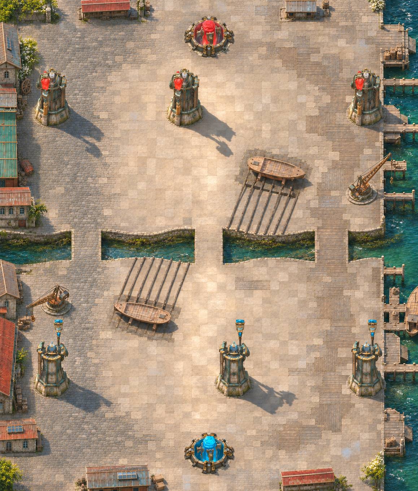

# 退潮船坞 · 晴日低潮

**美术概念提案**　从正式选图相机看雨后放晴的修船港。干石返暖，潮墙留着一道深青色的水位痕，港区仍在作业。下图是定稿时的概念图。三维实景、部署格和三座桥的实际做法见[退潮船坞](退潮船坞.md)。

| 部位 | 制作方向 | 实战镜头验收 |
| --- | --- | --- |
| 干湿与明暗 | 奶油灰、浅砂色石坪承接日光。背阴面偏冷，岸墙从顶部干石逐渐过渡到深青潮痕。港机少量用锈红和铜绿。 | 缩小画面时，先读到单位、阵营与三座桥。红蓝两端的兵都能从地面里分出来。 |
| 地格与道路 | 将主要暖冷色差对准步长 32、原点 (4, 8) 的落兵网格。西路旧石和作业坪在一到两格宽的路肩交错铺设，东路用齐平的短木板补片，中路靠石面磨亮和铺向引导。 | 徒步可横向通过的地方连续、开阔，玩家大致看得出落点；潮口和真实桥头仍有清楚的断面。 |
| 防御塔 | 做成船坞信号塔。保留红蓝识别和头部轮廓，让下部石脚、铸铜扣件、盐迹和接触阴影接进码头铺面。边塔承台朝场外展开，面向兵线的一侧采用齐平收口。 | 塔有重量，底座不会在可部署处制造高坎的错觉。 |
| 水晶 | 将水晶置入坞门驱动机座，少量铜质锚栓嵌入周围地坪，在水晶前留出平坦的出兵扇面。 | 能一眼认出水晶，看清三路出兵分流。 |

下一步可用一块代表性样段校色：蓝方西塔、同侧石桥和两路之间的作业坪，放入实际小兵并拖一张手牌。重点检查格子色差、塔脚落地和桥口辨识度，再将选定做法铺到全图。概念稿的中心高光可以在实战中回收，以小兵和落点清晰为准。

概念图的参考与生成提示

使用内置 image_gen 以当前地图的竖版选图预览为底先做日光材质改绘，再针对路缘做一轮局部材质修订。第二轮所用提示如下。

> Use case: precise-object-edit. Refine the supplied portrait harbor level concept without moving or restyling a single building, canal, bridge, ship, tower, crystal, or changing viewpoint or the sunshine, color scheme, bright pale limestone vs dark teal water. The art director requests a very specific revision to the dry ground in the playfield. Erase every thin gold, dark, metal, etched, curb or stone contour line that currently snakes round the looping outer roads: especially the double curves enclosing the grey cobblestone street past the upper-left red and lower-left blue towers, the curves linking each base, and the curves enclosing the timber road past the right towers. Replace each such contour with an irregular, gradual band of interlocking, staggered pavers: one cluster of small grey setts strays into the square limestone apron, 2–3 big flagstones interrupt the next row of setts, then a couple subtler worn stones. At the east, some square-format oak repair panels extend into the stone field at differing depths, stone inserts break up the adjacent zones, ends meet flush. At normal camera zoom one can follow routes from the orientation of the stones but one cannot trace a line around a road. Ensure it is easy to see troops can walk or be deployed on both sides of a material change. Make the wood and stone secondary roads only slightly darker than the main dry paving. Slightly CALM the contrast between adjoining square paving modules: preserve the meaningful visible square rhythm, sunbleached warm limestone color, subtler weathering/luma variance, broad highlight over the large central deployable yard. Remove distracting fine repetitive pepper-like grunge. Keep all physically meaningful sharp boundaries at water cut, bridges, quays, base plinths and boat-support tracks; the repaired work yard stays flat. Bridges wide and flat passable decks, no stairs. Keep the six towers, two crystals, and all other actual architecture faithfully as seen. Grounded realistic 3D harbor, no lettering, no new objects, no outlines. This is a ground material edit. Same single full-bleed image, same orientation.

