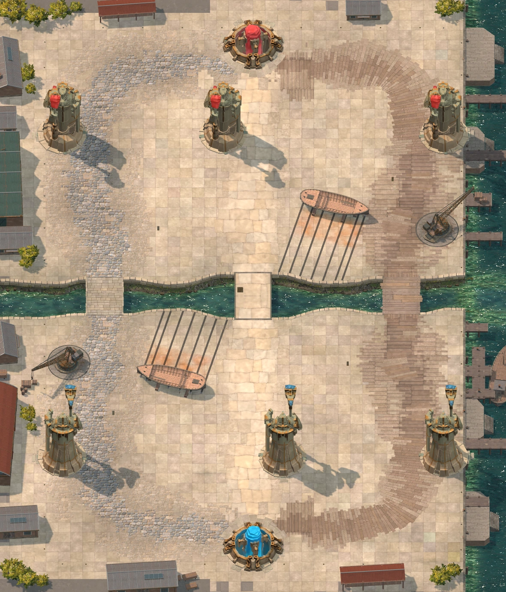

# 退潮船坞

退潮后，日光照亮浅砂色的修船作业坪。西侧仓库门前的旧石车道铺到石拱桥，中路直通钢梁牵引桥，东侧装卸场沿木栈桥接到外港。潮墙下方留有深绿色水痕，靠近水线能看见裸露的压顶石、海藻和藤壶。创建房间或选择「对战电脑玩家」时，可在「对战地图」中选用，支持经典 1v1 与 2v2，建议在电脑上游玩。



## 布局与对局

地图宽 1096、长 1744，蓝红两方的设施、碰撞轮廓、部署格与路线旋转 180° 对应。每方有一座水晶和三座防御塔，每路各守一座塔。三路小兵从水晶前的共同出兵点生成。中路直行，边路先向两侧展开再转向前线。同速小兵走边路到中线，比走中路约多 45% 的路程。[二维布局定稿](退潮船坞-二维布局.svg)

| 地点 | 地面单位 | 空中单位 |
| --- | --- | --- |
| 己方作业坪与两路之间 | 可在大多数格子部署，遇到视野内的邻路目标可转向 | 可从己方部署区起飞，直接接近目标 |
| 中央排水渠 | 普通地面单位从石拱车桥、钢梁牵引桥或木栈桥过渠 | 可从桥间的水面上空直接穿过 |
| 上架修船、吊机底座 | 绕开船体和支架、吊机接地的部分 | 可飞过设施 |

开局每方的普通地面单位置入点有 769 个，占己方 918 个格心的 83.8%。己方水晶和塔、船坞设施、渠边等都会影响实际落点。摧毁敌方塔后，原有的前推部署规则按对应的左、中、右路开放。岸外的仓库、泊船和货栈提供环境参照。

从水晶前的分岔口可以沿地面辨认三路。中路是被反复磨亮的浅色石坪，从中塔旁直通牵引桥。旧石大小不一，几点亮面延伸到路外，也有粗糙的补石穿进路心。两条边路先横过基地，再转向各自的外塔和桥头。西路的石缝积着浅砂，东路的旧板在装卸区接入作业坪，路间空地也能部署和通行。

部署网格每格 32 × 32，原点在地图坐标（4，8）。铺面的深浅保留格位参照，一道板缝或木排可以跨过多个格子。选中手牌后，地面按当前可部署格高亮，指针下的轮廓显示实际占格或施法范围。红方从另一端看同一组格子。

三处桥口的通行宽度均为 96。西桥为石砌拱券。中路铺石越过钢梁桥面，桥台留有伸缩缝，桥上嵌有检修盖。东桥用多种宽窄的长木板横铺，局部换入较浅的新板。板端参差，拼缝落在纵梁上，靠岸用短板接进装卸坪。每座信号塔下面都有一圈分块承重石和铜锚靴，水晶坐在带轴承的坞门机座上，朝向三路的出兵面留空。[晴日低潮概念稿](退潮船坞-晴日低潮概念.png)

在无干预的首波测试中，中路第 316 个逻辑步发现敌人，两条边路都是第 428 步，相差 5.6 秒。另一次测试将四种单位从同一点（340，1048）派向同一座敌塔。艾希走到左桥，在 x≈158 处越过中线。库奇直接飞过，卡萨丁与凯隐按各自的地形通行能力从桥间通过，三者的过线点都在 x≈267。

## 制作与复现

定稿矢量图保存绘图坐标。采样工具将轮廓转换为游戏坐标，逻辑内核和三维地形从同一份布局构建。游戏自带地形、船坞模型、环境光和两方底图，玩家首次进图从本地宿主加载资源。

在项目根目录运行以下命令。美术构建使用 Python、Pillow、Blender，采样和出图使用网页依赖中的 Playwright、esbuild 和本机 Chrome。

```sh
node tools/read_lowtide_plan.mjs
python3 tools/build_lowtide_map.py
python3 tools/lowtide_materials.py
python3 tools/build_lowtide_terrain.py
blender -b --python tools/lowtide_props.py
node tools/bake_lowtide.mjs
```

`content/lowtide-layout.json` 保存两岸、设施接地轮廓、桥和路线。`content/maps.json` 注册权威几何与地图入口。`harbor.glb` 包含桥体、地面、岸壁、海床和水面，`props.glb` 包含修船、吊机、仓库和外港设施。世界坐标下的风化贴图分别保存潮湿、铁锈、盐迹和近岸浅滩，供铺面和水面着色使用。选图预览从正式模型和建筑渲染，红蓝视角各有一张同机位环境底图。

## 材质来源

船坞地形和设施使用 Poly Haven 的 CC0 摄影材质。地面使用颜色、法线与粗糙度贴图，环境反射使用实拍天空。水面波纹、盐迹、船台锈水痕、桥体、船和装卸机械在本项目内制作。防御塔和水晶使用项目已有模型与动作，在这张地图中用受光的石材、铜绿和旧黄铜表现表面，保留阵营色、破损阶段与重建表现。[Poly Haven 素材许可](https://polyhaven.com/license)

西路选取概念图中空旷街面的错缝铺纹，去除大面积明暗后重建石缝起伏，再叠加实拍石孔。中路石块的高处磨出暖亮的矿物色，砂粒嵌在磨不到的低处和崩角里。磨损同时改变石块的颜色、表面起伏和粗糙度，移动镜头时反光会随之变化。东路用了深浅不同的旧木和补板，木纹取自实拍。水晶前的旧石从机座向三个路口铺开，构成双方共同的出兵坪。三路的阳光、建筑投影和水面反射由游戏镜头实时渲染。

- 作业坪、车道、干坞石板和潮泥。[水泥地坪](https://polyhaven.com/a/concrete_floor_02) · [石地坪](https://polyhaven.com/a/stone_floor) · [海蚀铺石](https://polyhaven.com/a/seaworn_stone_tiles) · [港区铺面](https://polyhaven.com/a/concrete_pavement_02) · [车间地面](https://polyhaven.com/a/hangar_concrete_floor) · [泥地](https://polyhaven.com/a/brown_mud_03)
- 船木、船漆、仓库和起重机械。[风化木板](https://polyhaven.com/a/weathered_planks) · [剥漆木料](https://polyhaven.com/a/weathered_peeling_timber) · [工业砖墙](https://polyhaven.com/a/factory_brick) · [波纹铁皮](https://polyhaven.com/a/worn_corrugated_iron) · [锈蚀钢材](https://polyhaven.com/a/rusty_metal_02)
- 天空反射使用 Greg Zaal 拍摄、Jarod Guest 处理的多云日光环境。[Kloofendal 48d Partly Cloudy](https://polyhaven.com/a/kloofendal_48d_partly_cloudy_puresky)
